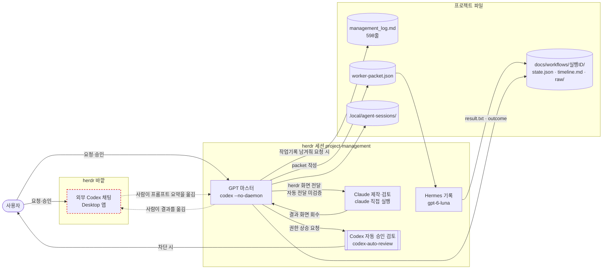
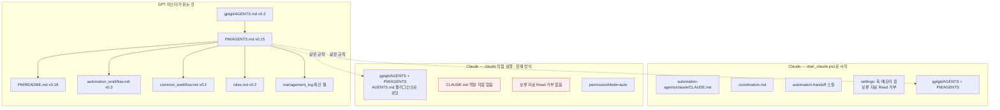
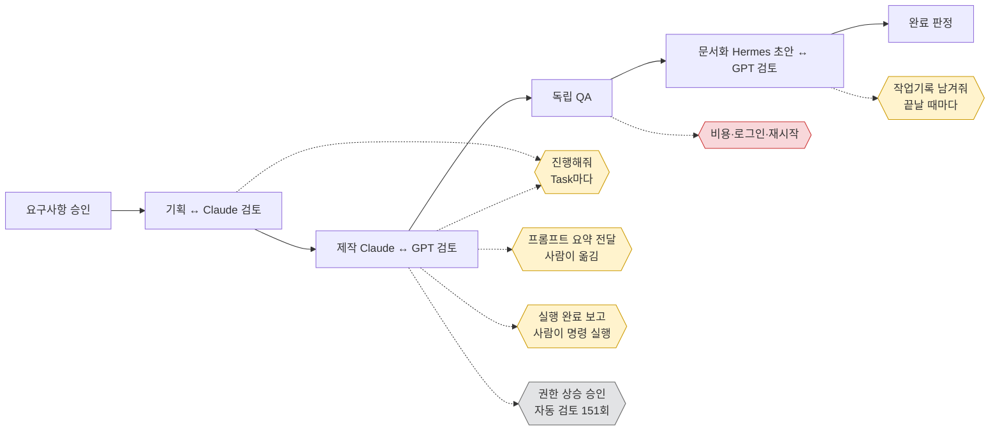

# 점검 보고서 — gptgit/project-management 자동화 프로토타입

> 작성 2026-10-29 (Stargazer PC) | 점검자: Claude Code (Opus 5.5) | 대상은 읽기만 했다.
> 경로는 `aigit` 기준 상대 경로다. `PM/`은 `gptgit/project-management/`를 줄인 표기다.
> 표시: **확인**(파일·기록에서 직접 봄) / **추정**(근거로 짐작) / **확인 필요**(아직 못 봄)

## 0. 한눈에 보기

| 점검 기준     | 결론                                                                    | 등급      |
| --------- | --------------------------------------------------------------------- | ------- |
| 컨텍스트 부하   | GPT 마스터는 시작과 맥락 복원만으로 창의 약 30%를 쓴다. 작업 중에는 94%까지 차서 압축이 7번 일어났다.      | **방해**  |
| 사용자 결정 지점 | 다시 지시한 것의 대부분이 "작업기록 남겨줘", "진행해줘", "프롬프트 전달"이다. 미리 규칙을 정하면 없앨 수 있다.   | 개선 여지 큼 |
| 지침 충돌     | `claude`를 직접 실행하면 Claude 전용 지침과 보류 자료 차단 설정이 빠진다.                     | **위험**  |
| 인계 구조     | 외부 Codex 결과를 herdr GPT로 사람이 옮겨 전달한다. Claude·GPT 간 자동 전달은 아직 검증되지 않았다. | 끊김 있음   |
| 루프 엔지니어링  | **조건부 가능.** Task 진행과 기록 저장은 지금도 가능하다. 제작↔검토 반복은 자동 전달이 먼저 필요하다.       | 조건부     |

---

## 1. 전체 구조 (시각화)

> Mermaid 도표다. Obsidian(이 PC에 설치됨)이나 GitHub에서 열면 그림으로 보인다.

### 1-1. 역할과 인계 흐름

빨간 점선은 사람이 손으로 옮기는 구간이다. 근거는 작업기록 `PM/docs/04_records/management_log.md` 558·569~577·594행이다(확인).

### 1-2. 지시 문서 사슬 — 실행 방식에 따라 달라짐

### 1-3. 작업 단계와 사람이 다시 개입하는 지점

- 노랑은 루프나 사전 규칙으로 없앨 수 있는 지점이다.
- 회색은 보안 관련이라 이번 점검에서 제외했다.
- 빨강은 사람이 꼭 결정해야 하는 지점이다.

---

## 2. 컨텍스트 부하 — "문서 읽느라 작업이 방해받는 정도"

### 2-1. 측정 방법
- **실측(관측):** 대상 폴더에서 실행된 세션 기록의 숫자 필드만 뽑았다. 본문은 옮기지 않았다.
  - Codex: `~/.codex/sessions/2026/10/`의 `token_count`와 `compacted` 이벤트
  - Claude: `~/.claude/projects/C--…-gptgit-project-management/`의 `usage`
- **추정:** 문서 글자 수에 **0.88토큰/글자**를 곱했다. 이 비율은 작업기록 49,959자를 Read 도구가 44,021토큰으로 표시한 실측에서 나왔다. GPT 토크나이저는 다를 수 있다(추정).
- **등급:** 창 대비 10% 미만은 가벼움, 10~30%는 주의, 30% 초과는 방해로 본다.

### 2-2. 역할별 결과

| 역할 | 세션 시작 직후 | 맥락 복원 후 | 작업 중 최대 | 등급 | 근거 |
| --- | --- | --- | --- | --- | --- |
| GPT 마스터 (gpt-6-astra, 창 258,400) | 약 36k (14%) | 약 78k (30%) | **244k (94%)**, 압축 발생 | **방해** | 관측: 세션 01a17b58·01a17b98·01a18212의 max 243~245k와 `compacted` 이벤트. 작업기록 553행 "79,342 / 258,400 = 30.7%"와 일치 |
| GPT 마스터 (gpt-6.1-sol, 창 475,000) | 약 23k (5%) | — | 387k (82%), 압축 1회 | 주의~방해 | 관측: 세션 01a13f24 (10-15) |
| Codex 자동 승인 검토 | 18~150k | — | 160k (62%), 압축 3회 | 주의 | 관측: codex-auto-review 세션 11개 |
| Claude 제작 (start_claude) | 48k | — | 51k | 창 크기 **확인 필요** (200k라면 24%) | 관측: 세션 295d9612 |
| Claude (직접 실행) | 52k | — | 52k | 같음 | 관측: 세션 178b02bd |
| Hermes worker | 1.3k | — | 1.3k | 가벼움 | 확인: `PM/docs/02_design/hermes_worker.md:60` |

**해석:**
- 마스터 세션에서 압축이 일어난 횟수는 이틀 사이 4번이다(01a13f24·01a17b58·01a17b98·01a18212). 자동 검토 세션까지 합치면 7번이다(관측).
- 사용자가 "굉장히 오래 걸린다", "작업기록 남기는 과정에서 문제가 있어 보인다"고 말한 시점이 이 구간과 겹친다(관측).
- 이 지연의 원인이 컨텍스트 부하라는 것은 **추정**이다. 서버 상태 등 다른 원인일 수도 있다.

### 2-3. 무엇이 많이 읽히나 (추정, 글자 수 × 0.88)

| 문서 | 글자 | 토큰(추정) | 맥락 복원 때 읽는가 |
| --- | ---: | ---: | --- |
| `PM/docs/04_records/management_log.md` 전체 | 49,959 | 44.0k (실측) | 원칙상 최신 절만(약 88줄, 6.5k). 기록을 덧붙일 때는 주변을 함께 읽게 됨(추정) |
| `PM/docs/02_design/management_workflow.md` | 12,224 | 10.8k | AGENTS 61·95행에서 참조 |
| `PM/README.md` | 10,058 | 8.9k | 매번 |
| `PM/docs/02_design/automation_workflow.md` | 9,163 | 8.1k | 2.1·2.2·4.1절 |
| `PM/docs/02_design/agent_session_lifecycle.md` | 8,461 | 7.4k | 재개 작업 시 |
| `PM/AGENTS.md` | 8,375 | 7.4k | 매번(자동 로딩) |
| `gptgit/docs/common_workflow.md` | 4,225 | 3.7k | 재개 시 |
| `roles.md`, `gptgit/AGENTS.md`, `gptgit/README.md` | 각 2.7~2.9k | 각 2.4~2.6k | 매번 |

- 맥락 복원 묶음을 더하면 약 42k다(추정). 시작 기본값 36k를 더하면 78k로, 실측 79k와 맞는다.
- 문서마다 같은 경고 문구가 되풀이된다: "commit·push 안 함", "전체 자동화 미완료", "가이드 보류". 그만큼 읽는 양이 늘어난다(확인: 작업기록 510·538·547·598행 등).
- 같은 날 절이 3개씩 쌓인다(10-27에 4개, 10-28에 3개). 그래서 최신 인계가 어느 절인지 찾는 데도 읽기가 든다(확인: 작업기록 5행이 최신 인계 위치를 따로 안내함).

### 2-4. 줄이는 방법 (제안)
1. **작업기록을 둘로 나눈다.** 지난 절은 보관용 파일로 옮기고, 본 파일에는 "현재 상태 + 다음 단계"만 둔다. 이렇게 하면 복원 묶음이 약 6.5k에서 2~3k 정도로 준다(추정). 다만 `PM/AGENTS.md:88`의 "동일 역할 사본 금지"와 부딪치지 않게, 보관 파일의 역할을 명시해야 한다.
2. **되풀이되는 경고를 한 곳에 모은다.** "항상 유지하는 제한" 목록을 AGENTS 한 곳에 두고, 기록에서는 "제한 변경 없음"만 적는다.
3. **마스터는 Task가 끝날 때마다 새 세션으로 넘긴다.** 이 원칙은 이미 있다(`automation_workflow.md:37`). 하지만 마스터 자신에게는 적용하지 않아 한 세션이 94%까지 찬다(관측). 마스터 교대 기준도 넣는다. 예: 창 50%를 넘으면 인계 후 교대.

---

## 3. 사용자 결정 지점

### 3-1. 실제로 다시 지시한 것 (마스터 세션의 짧은 지시, 10-25~28)

| 유형 | 횟수 | 예 | 판정 |
| --- | ---: | --- | --- |
| 작업기록 저장 요청 | 9 | "작업기록 남겨줘", "작업 기록 저장해주고…" | **미리 정하면 제거 가능** |
| 진행·계속 | 7 | "진행해", "다음 작업 진행해줘", "계속 진행해줘" | **루프로 대체 가능** |
| 번호로 선택 | 3 | "1번부터 진행하자", "2번 제안한 방식대로…" | 미리 정하면 제거 가능(추천안 기본 채택) |
| 프롬프트 전달 요약 | 2 | "전달할 프롬프트 요약해서 알려줘" | 구조 문제(인계, 4절) |
| 사람이 실행 후 보고 | 3 | "실행 완료", "실행 완료 입력 화면 듬" | 구조 문제(herdr 바깥에서는 제어 불가) |
| 의미 질문 | 3 | 출력 줄 수·대화 ID의 뜻 | 보고 형식 개선 대상 |
| 상태·지연 문의 | 4 | "지금 어떤 문제가 있어?", "현재 gpt 상태가 어때?" | 컨텍스트 부하와 관련(추정) |

출처는 Codex 세션 기록의 사용자 메시지 중 80자 이하인 것이다. 유형만 세었고, 위 예는 사용자가 쓴 짧은 지시 그대로다(관측).

### 3-2. 규칙 때문에 생기는 결정 지점

| 규칙 | 위치 | 꼭 필요? | 의견 |
| --- | --- | --- | --- |
| 파일 반영은 명시 요청이 있을 때만 | `PM/AGENTS.md:74-79` | **아님(승인된 자동화 실행 안에서는)** | 같은 문서 119·122행은 승인된 실행의 기록·인계를 허용한다. 두 규칙의 경계가 모호해 "작업기록 남겨줘"가 반복된다(추정) |
| 비용·핵심 범위·외부 공개·되돌리기 어려운 선택 | `PM/AGENTS.md:114`, `roles.md:38` | **필요** | 유지 |
| Hermes 로그인·플랜 공유 동의 | 작업기록 494행 | **필요(1회)** | 이미 "다음 재개에도 유지"로 정했다. 좋은 예 |
| Windows 재시작·LongPaths·관리자 권한 | 작업기록 393·526·582행 | 필요(보안·시스템) | 제외 대상 |
| Codex 권한 상승 자동 검토 | 세션 기록: codex-auto-review 세션 11개, 검토 요청 약 151회, 누적 약 1,310만 토큰 | 보안이라 제외 | 다만 **비용이 크다**. 토큰은 구독 한도에서 빠진다(관측: 토큰 합계는 누적·캐시 포함) |
| Claude 시작기의 권한 모드 `manual` | `PM/tools/start_claude.ps1:33` | 확인 필요 | 실제 기록에는 `default`로 남았다(세션 295d9612). 도구를 쓸 때마다 Claude 창에서 승인을 묻는지 확인 필요 |

---

## 4. 지침 충돌 (AGENTS ↔ CLAUDE)

| 항목 | Codex 쪽 (AGENTS) | Claude 쪽 (`automation-agents/claude/`) | 실제 직접 실행(`claude`) | 판정 |
| --- | --- | --- | --- | --- |
| 역할 지침 | `roles.md` 표 | `CLAUDE.md` "마스터 지시 전 파일 수정 금지" | **로딩 안 됨**. 세션 178b02bd에 Claude 역할 지침 문구 0회 | **확인 — 빠짐** |
| 보류 자료 보호 | AGENTS·작업기록의 "보류" 문구 | 시작기에서 Read 거부 4개 (`start_claude.ps1:24-29`) | **적용 안 됨** | **확인 — 위험**. 보류 중인 가이드 HTML을 Claude가 읽을 수 있음 |
| 공통·관리 AGENTS | 자동 로딩 | 시작기가 AGENTS를 함께 로딩 | 로딩됨(AGENTS.md 플러그인) | 확인 — 일치 |
| 권한 모드 | — | `manual` (시작기) | `auto` (세션 178b02bd) | 확인 — 다름. 자동 실행 범위가 실행 방식에 따라 달라짐 |
| 훅 | — | `disableAllHooks: true` (`automation-agents/claude/.claude/settings.json`) | 사용자 설정을 따름 | 확인. **루프 플러그인(ralph-loop)은 훅이 꺼지면 동작하지 않음** |
| 기존 Claudecode 지침 | — | 제외 (`start_claude.ps1:23`) | 경로상 로딩 안 됨(형제 폴더). `~/.claude/CLAUDE.md` 없음 | 확인 — 영향 없음 |
| Git 권한 | 명시 요청 시만 (`gptgit/AGENTS.md`) | commit·push 금지 | AGENTS를 따름 | 일치 |
| 비용 | 구독 범위, API 전환 금지 (`PM/AGENTS.md:114`) | 같음 + API 키 환경변수 검사 (`start_claude.ps1:12-13`) | 환경변수 검사 없음 | 부분 일치 |
| 문서 수정 권한 | 명시 요청 시만 (74~79행) | 마스터가 지정한 파일만 | AGENTS만 적용 | 서로 다른 기준(사용자 요청 vs 마스터 지시). 자동화 실행 중 우선순위가 정해져 있지 않음(추정) |

**핵심:** 작업기록 578행에 따르면 사용자는 지금 `claude`를 직접 실행하고 있다. 이 경우 Claude 전용 지침이 **실제로 하나도 적용되지 않는다**(확인). 해결 방법은 둘 중 하나다.
- (a) herdr 안에서도 `start_claude.ps1`로 시작한다.
- (b) 꼭 필요한 Claude 규칙을 `PM/CLAUDE.md`에 둔다. 이 경우 Read 거부 설정은 `PM/.claude/settings.json`으로 옮긴다.

---

## 5. 인계 구조

| 구간 | 전달 수단 | 상태 | 근거 |
| --- | --- | --- | --- |
| 사용자 → 외부 Codex → herdr GPT | 사람이 프롬프트 요약을 복사 | **끊김(수동)** | 작업기록 558·594행, 사용자 지시 "전달할 프롬프트 요약해서 알려줘" |
| herdr GPT → 외부 Codex | 사람이 결과를 복사. raw 파일 없음 | **끊김** | 작업기록 577행 "별도 내부 raw 출력 파일은 확보하지 않았다" |
| GPT 마스터 → Claude | herdr 화면 입력, 확인 문구만 시험 | 자동 전달·작업 수행 미검증 | 작업기록 451·593행 |
| GPT 마스터 → Hermes | `worker-packet.json` → raw 폴더 | **잘 됨**. 해시·중복 방지·구독 확인 | `hermes_worker.md:43-54` |
| 세션 간 (새 Task) | 작업기록 최신 절 + 원본 절 | 복원 시험 통과(분리 담당) | 작업기록 550·587행 |
| process_debug 연결 | `debug/state.json` bind | **오류**: 세션 ID에 들어 있는 `/`를 거절함, 미수정 | 작업기록 552·588행 |
| 대화 ID 기록 | `.local/agent-sessions/` | 사용자 보고로만 기록(`source=user_report`) | `agent_session_lifecycle.md:9` |

**가장 큰 끊김:** 외부 Codex(Desktop)와 herdr GPT가 둘 다 "마스터"처럼 움직인다. 사용자가 그 사이를 손으로 잇는다. 10-28에 "사용자 창구는 herdr GPT로 통일"이라고 정했지만(558행), 그 뒤로도 외부 Codex에서 작업이 이어졌다(사용자 확인 2026-10-29). 사용자는 herdr 개선이 끝난 뒤 herdr 안에서 작업할 예정이다.

---

## 6. 루프 엔지니어링 도입 가능 여부

> 루프란 AI가 정해진 종료 조건에 닿을 때까지 "실행 → 확인 → 다음/수정"을 스스로 반복하는 방식이다. 사람은 처음 승인과 멈춤 사유가 생겼을 때만 개입한다.

### 6-1. 이미 있는 재료 (확인)
- **종료 조건:** 같은 결함이 2번 수정 후에도 반복되거나 검토가 3번을 넘으면 마스터가 재평가한다(`automation_workflow.md:56`).
- **상태 기계(작업 단계를 정해진 순서로만 넘기는 장치):** `workflow.py`의 start/submit/review/complete/block/reassess가 실패 QA에서 통과를 막는다(`automation_workflow.md:138-140`).
- **중복 실행 방지:** operation ID 재사용, Hermes는 같은 작업 ID를 재전송하지 않는다(`hermes_worker.md:43,54`).
- **멈춰야 할 사유:** 로그인 실패, 도구 없음, 한도 소진, 실행 실패, 검증 불일치(`automation_workflow.md:57`).
- **세션 분할은 재승인이 필요 없다**(`automation_workflow.md:39`).

결국 **루프를 멈추게 할 브레이크는 이미 설계돼 있다.** 없는 것은 "멈출 이유가 없으면 다음으로 넘어가라"는 가속 규칙이다.

### 6-2. 재결정 지점별 판정

| 지점 | 판정 | 필요한 것 |
| --- | --- | --- |
| "진행해줘"(Task마다) | **루프로 대체 가능** | 규칙: "승인된 실행계획의 Task는 6-1의 멈춤 사유가 없으면 차례로 진행한다." 마스터 안에서 동작하므로 새 도구가 필요 없다 |
| "작업기록 남겨줘" | **사전 규칙으로 제거 가능** | 규칙: "승인된 실행에서는 Task가 끝날 때 timeline·state를, Phase가 끝날 때 작업기록 요약을 자동 기록한다." AGENTS 74~79행에 예외를 명시해야 함 |
| 번호 선택 | 사전 규칙으로 제거 가능 | 규칙: "되돌리기 쉬운 선택은 추천안으로 진행하고 보고에만 적는다." 이미 `PM/AGENTS.md:58`과 같은 취지다. 실행 시 적용이 약함(추정) |
| 제작 Claude ↔ GPT 검토 반복 | **조건부** | herdr를 통한 자동 전달·회수가 먼저 검증돼야 한다(작업기록 451행 미검증). 그 전까지는 사람이 옮겨야 해서 루프가 끊긴다 |
| 프롬프트를 사람이 전달 | 루프 아님 → **구조 정리** | 창구를 herdr GPT 하나로 지킨다. 외부 Codex는 점검·조언용으로만 둔다 |
| "실행 완료" 보고 | 루프 아님 → 구조 | herdr 안의 마스터가 직접 실행하면 사라진다(Desktop은 herdr 제어 불가, 448행) |
| Hermes 재시도 | **루프 금지** | 자동 재전송 금지 규칙(595행)을 유지한다. 루프는 새 작업 ID로만 다시 보낸다 |
| 비용·로그인·공개 | 루프 불가 | 사람이 결정 |

### 6-3. 쓸 수 있는 루프 수단

| 수단 | 상태 | 이 프로젝트에 맞나 |
| --- | --- | --- |
| **마스터 규칙 + `workflow.py`** | 있음 | **가장 적합.** 새 설치가 없고 브레이크도 이미 있다 |
| Claude `ralph-loop` 플러그인 | 공식 마켓, 미설치 | **부적합(현재).** ① Claude는 작업 담당이지 마스터가 아니다. ② 시작기가 훅을 끄므로(`disableAllHooks: true`) Stop 훅 기반인 이 플러그인은 동작하지 않는다(설정에서 확인, 실제 동작은 미시험). ③ 같은 프롬프트를 되먹이면 한 세션에 맥락이 쌓인다. 마스터가 이미 94%까지 찬 상황과 맞지 않다 |
| Claude `/loop` 스킬 | 설치됨 | 일정 간격으로 반복하는 용도라 Task 진행 루프와는 다르다. 오래 걸리는 작업의 상태 확인에만 쓸 만하다 |
| Codex 쪽 반복 실행 기능 | **확인 필요** | 이 세션에서는 설치된 Codex 버전의 문서를 확인하지 못했다 |

### 6-4. 루프를 도입할 때의 위험
- **컨텍스트:** 한 세션에서 루프를 돌리면 2절의 "방해" 상황이 더 나빠진다. 그래서 **Task 하나 = 새 세션**을 지키고, 마스터도 교대 기준(창 50%)을 둬야 한다(제안).
- **비용:** 루프 한 번이 구독 한도를 쓴다. 권한 상승 자동 검토가 이미 이틀에 약 151회 일어났다(관측). 루프가 권한 상승 명령을 반복하면 이 수가 늘어난다. 상한 예시: 한 Phase에 Task 최대 N개, 검토 3회(기존 규칙).
- **지침 빈틈:** 4절처럼 Claude 지침이 빠진 상태로 루프가 돌면, 보류 자료를 읽는 일을 막을 수 없다.

### 6-5. 결론 — **조건부 가능**
1. **지금 바로:** "멈춤 사유가 없으면 다음 Task로" 규칙과 "승인 실행 안에서는 기록 자동 저장" 예외를 넣는다. 그러면 "진행해줘"와 "작업기록 남겨줘" 약 16번이 사라진다(10-25~28 기준, 추정). AGENTS 수정이 필요하므로 사용자 결정 사항이다.
2. **먼저 할 일:** Claude 지침 적용 경로를 정리한다(4절). 그리고 herdr 자동 전달 시험(작업기록 593행의 짝수 합 시험)을 통과시킨다.
3. **그 다음:** 제작↔검토 루프를 기존 재평가 규칙(2회 수정·3회 검토) 안에서 자동화한다.
4. 플러그인은 설치하지 않는다. 필요해지면 그때 다시 검토한다.

---

## 7. 남은 확인 사항 (2026-10-29 사용자 답변 반영)
| 항목 | 상태 |
| --- | --- |
| Mermaid 도표가 Obsidian에서 그려지는지 | **확인됨.** 다만 폭이 넓어 가로 스크롤이 필요하다. 개선은 보류 |
| Claude Pro의 Opus 5.5 컨텍스트 창 크기 | 보류. herdr 개선을 더 확인한 뒤에 본다 |
| `--permission-mode manual`의 실제 동작(기록에는 `default`) | 사용자가 나중에 확인 |
| 지연 원인(컨텍스트 부하 또는 서버) | 서버 문제였을 수도 있다. 다시 생기면 조사 |
| 외부 Codex와 herdr 중 작업 위치 | **확인됨.** 외부 Codex에서 작업했다 |
| Claude 시작 방식(§4) | 사용자 판단: `start_claude.ps1`은 단순 실행기다. herdr 안에서 Codex로 실행할 때와 무엇이 다른지 Codex를 통해 확인한 뒤 개선을 요청할 예정 |
| 설치된 Codex에 반복 실행 기능이 있는지 | 확인 필요(미착수) |

## 8. 비밀값 관련
아래 위치는 내용을 읽거나 옮기지 않았고 위치만 적는다.
- `PM/.local/hermes-setup/`
- `PM/.local/agent-sessions/`
- `PM/docs/workflows/guide-prototype/raw/guide-production-auth-check.json`
- `~/.codex/sessions/`·`~/.claude/projects/…` 원문(숫자와 짧은 지시 유형만 사용)
