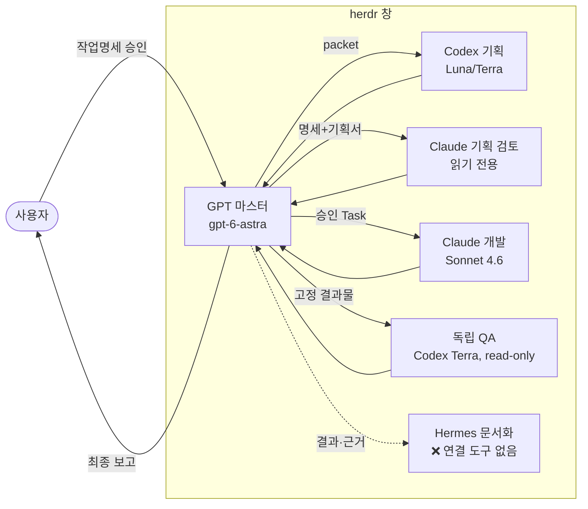
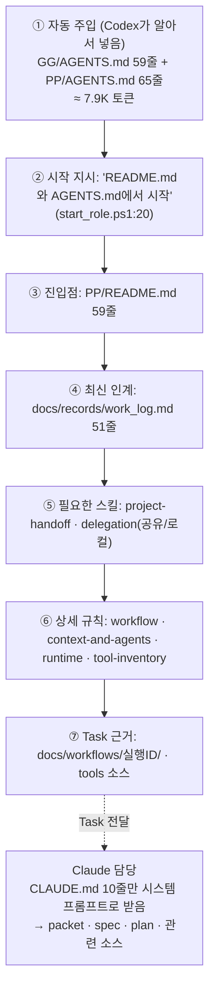
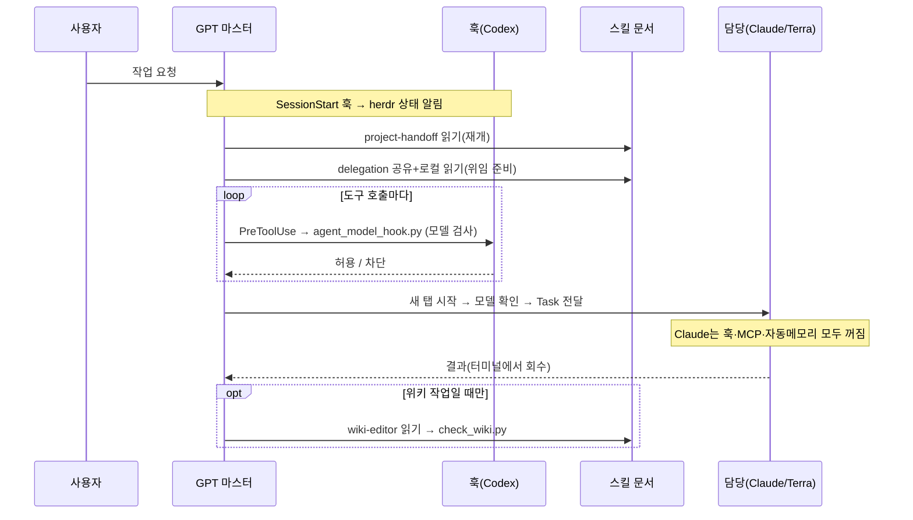
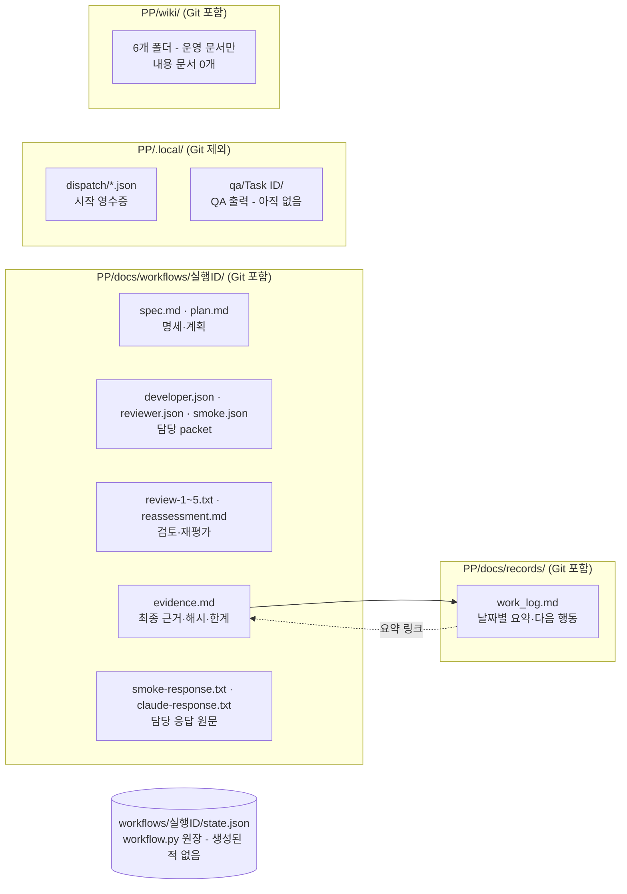

# 점검 보고서 — gptgit/project-prototype 작업 흐름

> 작성 2026-11-10 (ICT PC) | 점검자: Claude Code (Opus 5.5) | 대상은 읽기만 했다(점검 전후 `git status` 변경 0건).
> 경로는 `Aigit` 기준 상대 경로다. `PP/`는 `gptgit/project-prototype/`, `GG/`는 `gptgit/`을 줄인 표기다.
> 표시: **확인**(파일·세션 기록에서 직접 봄) / **추정**(근거로 짐작) / **확인 필요**(아직 못 봄)
> 줄 수는 빈 줄 포함, 토큰은 글자 수 × 0.88로 어림한 값이다(실측 비율, WORK_LOG §2).

## 0. 한눈에 보기

| 점검 항목 | 결론 |
| --- | --- |
| 문서 읽는 순서 | 마스터(GPT Astra)는 시작할 때 문서 약 20개를 읽는다. 이것만으로 창의 **32%**(약 8.2만 토큰)가 찬다. 첫 묶음은 글자가 깨져 **같은 6개 문서를 두 번** 읽었다. 담당(Claude·Terra)은 전달받은 2~4개 파일만 읽어 가볍다. |
| 스킬·훅·플러그인 | 스킬 6개 중 실제로 읽힌 것은 3개다(handoff, 공유·로컬 delegation). 훅은 Codex 쪽 2개만 켜져 있고, Claude 쪽은 모두 꺼 두었다. 모델 검사 훅이 실제로 막은 것은 11-06 시험 1건뿐이다. |
| 툴 | 실제로 쓰인 것: `dispatch_task.py`(35회), `start_role.ps1`(15회), herdr 명령 약 120회. **`workflow.py`(상태 원장, 417줄)는 한 번도 실행되지 않았다.** Hermes 연결 도구는 아직 없다. |
| 작업 후 기록 | 실행마다 `PP/docs/workflows/<실행ID>/`에 명세·계획·packet·검토·근거를 남기고, `PP/docs/records/work_log.md`에 요약을 남긴다. 위키는 폴더만 있고 내용 문서는 0개다. |
| 사용자 결정 | 11-09 마스터 세션에서 사용자 입력은 4번뿐이다(요청 2번 + "진행해줘" + "작업기록 남겨줘"). 하지만 **권한 상승 요청이 89번** 있었고, 이 세션의 승인 검토자는 `user`였다 → 사용자가 직접 눌렀을 가능성이 높다(**확인 필요**). |

---

## 1. 전체 구조

> Mermaid 도표다. Obsidian이나 GitHub에서 열면 그림으로 보인다(이 PC에서 화면 렌더링은 확인하지 않았다).

- 설계상 단계: 요구사항 → 기획 작성 → 기획 검토 → 개발 → 독립 QA → 문서화 (`PP/docs/workflow.md:9-20`) — **확인**
- 실제로 돌려 본 것(11-09): 마스터 → Claude 개발 → Terra 검토 → 실연결 시험(Claude) 까지. 기획 단계·정식 QA·Hermes는 미실행 (`PP/docs/records/work_log.md:21`) — **확인**

---

## 2. LLM이 문서를 읽는 순서와 양

### 2-1. 규칙이 정한 순서 (문서 기준)

근거: `GG/docs/common_workflow.md:21-22`(README→AGENTS→상세→최신 인계), `GG/AGENTS.md:37`(필요한 원본만), `PP/tools/start_role.ps1:20,43-45` — **확인**

### 2-2. 실제로 읽은 순서 (11-09 마스터 세션 `01a1bd9c`, 처음 6번의 읽기 묶음)

| 묶음 | 읽은 문서 (순서대로) | 창 사용량(누적) |
| --- | --- | --- |
| 시작 | 자동 주입 AGENTS 2개 + 시스템 지침 | 22.9K |
| 1 | README → AGENTS → work_log(끝 180줄=전체) → 공유 handoff 스킬 → 공유 delegation 스킬 → 로컬 delegation 스킬 | 45.4K |
| 2 | **위 6개를 다시** 읽음(1번 출력이 한글 깨짐 → `-Encoding UTF8` 붙여 재실행) + context-and-agents | 54.3K |
| 3 | runtime → `GG/README` → `GG/docs/common_workflow` → delegation `references/runtime` → config 2개 | 65.3K |
| 4 | `start_role.ps1` → `dispatch_task.py` → packet 양식 → CLAUDE.md → `task_packet.py` → tool-inventory → workflow_packets | 75.0K |
| 5~6 | herdr 도움말 → `check_agent_model.py` → .gitignore → **AGENTS(3번째)** → **`GG/AGENTS`(자동 주입분 재조회)** → 양식 2개 → workflow.md(앞 65줄) | 82.1K (창 258K의 **32%**) |

- 세션 최대 사용량은 197.7K(창의 **76%**), 누적 입력은 1,936만 토큰(99%가 캐시) — **확인**
- 읽지 않은 문서: `docs/requirements.md`, `docs/development-plan.md`, wiki 전체, `wiki-editor` 스킬 — **확인**(이번 작업과 무관해서 정상)
- 반복 읽기: work_log 3회, 공유·로컬 delegation 스킬 각 3회, `dispatch_task.py` 3회, `config/runtime.local.json` 4회 — **확인**

### 2-3. 담당별 읽기 (같은 날 다른 세션)

| 담당 · 세션 | 읽은 것 | 최대 창 사용 |
| --- | --- | --- |
| Claude 개발 `b82d9a2a` | CLAUDE.md(프롬프트) → developer.json → spec.md → plan.md → dispatch_task.py → test | 확인 필요 |
| Terra 검토 `01a1be25` | 자동 AGENTS 2개 → spec → plan → dispatch_task.py·test 각 **5회**(검토 5회차) | 53.6K / 475K (11%) |
| Claude smoke `474db724`, `39ac2210` | spec·plan 2개만 | — |

→ "담당에게는 필요한 것만 준다"(`PP/AGENTS.md:27`)는 규칙은 **지켜지고 있다**. 무거운 쪽은 마스터뿐이다.

### 2-4. 문서·줄 수 표

| 문서 | 줄 | 토큰≈ | 누가 읽나 | 11-09 마스터 실제 |
| --- | --- | --- | --- | --- |
| `GG/AGENTS.md` | 59 | 3.1K | 자동(Codex 전원) | 자동 + 1회 |
| `GG/README.md` | 58 | 2.7K | 마스터 | 1 |
| `GG/docs/common_workflow.md` | 68 | 3.7K | 마스터 | 1 |
| `PP/AGENTS.md` | 65 | 3.7K | 자동(Codex 전원) | 자동 + 3회 |
| `PP/README.md` | 59 | 2.0K | 마스터 | 2 |
| `PP/CLAUDE.md` | 10 | 0.6K | Claude(프롬프트) | 2 |
| `PP/docs/workflow.md` | 72 | 3.0K | 마스터 | 1(앞 65줄) |
| `PP/docs/context-and-agents.md` | 62 | 2.5K | 마스터 | 1 |
| `PP/docs/runtime.md` | 51 | 2.8K | 마스터 | 1 |
| `PP/docs/tool-inventory.md` | 29 | 1.4K | 마스터 | 1 |
| `PP/docs/requirements.md` | 16 | 0.6K | 마스터 | 0 |
| `PP/docs/development-plan.md` | 15 | 0.7K | 마스터 | 0 |
| `PP/docs/records/work_log.md` | 51 | 5.1K | 마스터 | 3 |
| `PP/tools/workflow_packets.md` | 83 | 2.8K | 마스터 | 1 |
| 스킬 6개 SKILL.md 합 | 189 | 11.5K | 해당 작업 시 | 3개 × 2~3회 |
| `GG/skills/delegation-reporting/references/runtime.md` | 27 | 1.6K | 마스터 | 1 |
| `PP/wiki/` 운영 문서 9개 | 약 90 | 2.5K | 위키 작업 시 | 0 |
| **규칙 문서 합계** | **약 1,000줄** | **약 50K** | | |

툴 소스도 마스터가 직접 읽는다: `start_role.ps1` 65줄, `dispatch_task.py` 244줄(10.7K), `task_packet.py` 155줄(7.6K), `workflow.py` 417줄(19.2K), `check_agent_model.py` 39줄.

---

## 3. 스킬·훅·플러그인

### 3-1. 목록

| 종류 | 이름 | 위치 | 언제 쓰나 (규칙) | 11-09 실제 |
| --- | --- | --- | --- | --- |
| 스킬(공유) | project-handoff | `GG/skills/` 31줄 | 재개·인계 점검 | 읽음 ×2 |
| 스킬(공유) | delegation-reporting | `GG/skills/` 28줄 + references 27줄 | 담당 위임 | 읽음 ×3 |
| 스킬(공유) | project-planning | `GG/skills/` 27줄 | 초기 기획 | 안 읽음 |
| 스킬(공유) | simple-user-guide | `GG/skills/` 64줄 (개인 설치본 `~/.codex/skills/`에도 있음) | 가이드 작성 | 안 읽음 |
| 스킬(로컬) | delegation-reporting | `PP/skills/` 16줄 | 위임 시 프로젝트 규칙 연결 | 읽음 ×3 |
| 스킬(로컬) | wiki-editor | `PP/skills/` 23줄 + schema 44줄 + 틀 4개 | 위키 작성 | 안 읽음 |
| 훅(Codex, 전역) | SessionStart → `~/.codex/herdr-agent-state.ps1` | `~/.codex/hooks.json` | 세션 시작마다 | 작동(신뢰 등록됨) — 용도는 herdr 상태 알림으로 **추정** |
| 훅(Codex, 프로젝트) | PreToolUse → `GG/tools/agent_model_hook.py` | `PP/.codex/hooks.json` | **모든 도구 호출 직전**(matcher `.*`, 5초) | 작동, 11-09 차단 0건. 11-06 Luna 시험에서 1건 차단(`work_log.md:37`) |
| 훅(Claude) | 없음 | `start_role.ps1:43` `disableAllHooks=true` | — | 꺼짐 |
| 플러그인(Codex) | 10개(browser, documents, pdf, computer-use 등) | `~/.codex/config.toml` 전역 | 프로젝트와 무관하게 항상 켜짐 | 사용 흔적 없음 |
| 플러그인/MCP(Claude) | 없음 | `--strict-mcp-config` 빈 설정, `--setting-sources project` | — | `/mcp` "No MCP servers" (`evidence.md`) |

### 3-2. 언제 무엇이 작동하나

---

## 4. 툴 목록과 작동 순서

### 4-1. 목록

| 툴 | 줄 | 용도 | 누가·언제 | 11-09 실제 |
| --- | --- | --- | --- | --- |
| `PP/tools/start_role.ps1` | 65 | 역할별 CLI 시작. packet 검사 → 모델 검사 → 유료 API 환경변수 차단 → 로그인·구독 확인 → 실행 | 마스터, 담당 시작 시 | 15회 |
| `PP/tools/dispatch_task.py` | 244 | packet·모델 검사 → herdr **새 탭** 생성 → pane에서 `start_role` 실행 → 중복 방지 영수증 | 마스터, `--apply`로 실제 시작 | 35회(대부분 시험) |
| `PP/tools/task_packet.py` | 155 | Task 입력(JSON) 필수 항목·경로·쓰기 범위 검사. 읽기 전용 | 위 두 툴이 호출 | 2회 직접 + 간접 |
| `GG/tools/check_agent_model.py` | 39 | 역할별 허용 모델 검사(Astra=마스터, Luna/Terra=하위) | 위 두 툴이 호출 | 2회 직접 + 간접 |
| `GG/tools/agent_model_hook.py` | 148 | PreToolUse 훅. `herdr agent start` 등에서 금지 모델 차단 | Codex가 자동 | 매 호출 |
| `PP/tools/workflow.py` | 417 | 실행 상태 원장(init/start/submit/review/complete…). LLM은 호출 안 함 | 마스터, 단계마다 | **0회** |
| `PP/tools/check_structure.py` | 30 | 필수 파일 15개·상대 링크 검사 | 마스터, 기록 저장 후 | 2회 |
| `PP/skills/wiki-editor/scripts/check_wiki.py` | 155 | 위키 문서 형식 검사 | 위키 작업 후 | 0회 |
| `PP/tests/` 4개 | 857 | 위 툴들의 회귀 시험 | 툴 수정 후 | dispatch 시험 29회 |
| herdr CLI | — | 탭·pane·담당 제어(`agent read/prompt/wait/get`) | 마스터 | 약 120회 |

### 4-2. 담당 1명을 시작해 결과를 받기까지

```mermaid
sequenceDiagram
    participant M as 마스터
    participant DT as dispatch_task.py
    participant TP as task_packet.py
    participant CM as check_agent_model.py
    participant HD as herdr
    participant SR as start_role.ps1
    participant W as 담당 CLI
    M->>DT: packet.json (먼저 검사만)
    DT->>TP: 필수 항목·경로·쓰기 범위
    DT->>CM: 역할·모델 허용 여부
    M->>DT: --apply
    DT->>DT: .local/dispatch/영수증 선점(중복 차단)
    DT->>HD: tab create --no-focus (새 탭)
    DT->>HD: pane process-info (최대 3회 준비 확인)
    DT->>HD: pane run → start_role.ps1
    HD->>SR: 실행
    SR->>TP: packet 재검사
    SR->>CM: 모델 재검사
    SR->>SR: 유료 API 변수 차단·로그인/구독 확인
    SR->>W: "대기하세요" 프롬프트로 시작 (Task 미전달)
    M->>HD: agent get / /status → 실제 모델·권한 확인
    M->>HD: agent prompt (Task 1회 전달)
    M->>HD: agent wait → agent read (결과 회수)
    Note over M: 설계상 다음은 workflow.py submit/review<br/>→ 실제로는 미사용, 근거는 evidence.md에 수기 작성
```

근거: `PP/tools/start_role.ps1:20-61`, `PP/tools/dispatch_task.py:125-228`, `PP/docs/runtime.md:13-23` — **확인**

---

## 5. 작업 후 무엇을 어디에 남기나

| 시점 | 남기는 것 | 위치 | 규칙 근거 |
| --- | --- | --- | --- |
| 실행 시작 | 명세·계획 | `docs/workflows/<id>/spec.md`, `plan.md` | `PP/docs/workflow.md:55` |
| 담당 시작 | 영수증 | `.local/dispatch/<해시>.json` | `dispatch_task.py:165-173` |
| 검토마다 | 검토 결과·재평가 | `review-N.txt`, `reassessment.md` | `PP/docs/workflow.md:47-48` |
| Task 완료·차단 | 근거·해시·한계 | `evidence.md` | `PP/docs/workflow.md:57` |
| Phase 종료·인계 | 요약·근거 링크·다음 행동 | `docs/records/work_log.md` | `PP/docs/workflow.md:57`, `work_log.md:5-9` |
| 문서화 | 위키 초안 | `wiki/<분류>/` | `PP/docs/workflow.md:19` → **Hermes 미구현으로 실제 0건** |

---

## 6. 점검 기준별 발견

### 6-1. 사용자 결정 지점
- **꼭 필요한 것(유지):** 작업명세 승인, 비용·외부 공개·되돌리기 어려운 선택 (`PP/AGENTS.md:9,12`) — **확인**
- **줄일 수 있는 것:**
  1. 권한 상승 요청 89건. 마스터 세션의 승인 검토자가 `user`였다(세션 `turn_context`). `start_role.ps1:39`는 Codex를 `auto_review`로 시작하므로, **마스터는 start_role로 시작되지 않은 것으로 추정**한다. 마스터도 start_role(또는 같은 옵션)로 시작하면 사용자 클릭을 줄일 수 있다. 실제로 사용자가 몇 번 눌렀는지는 **확인 필요**.
  2. "진행해줘", "작업기록 남겨줘"(각 1회). 규칙상 승인 범위 안에서는 마스터가 계속 진행하고 기록하게 되어 있다(`PP/AGENTS.md:10,18`). 그런데도 마스터가 첫 Task 뒤 멈췄다. 이전 점검(10-29)과 같은 패턴이다 — **확인**

### 6-2. 비용(문서량)
- 마스터 시작 비용 약 8.2만 토큰(창의 32%). 이 중 약 2.3만은 **글자 깨짐으로 다시 읽은 몫**이다 — **확인**
- 자동 주입된 AGENTS 2개를 다시 `Get-Content`로 읽었다(PP 3회, GG 1회) — **확인**. 규칙의 "자동 제공 지침과 직접 읽는 문서를 구분한다"(`PP/AGENTS.md:28`)가 실제로는 재조회를 막지 못한다.
- 비슷한 원칙("구분한다", "주장하지 않는다")이 AGENTS·README·workflow·runtime·스킬에 반복된다. 규칙 문서는 약 1,000줄, 5만 토큰이다 — **확인**(반복 정도는 **추정**)
- `workflow.py`(19K 토큰 분량)는 읽히기만 하고 실행되지 않는다 — **확인**

### 6-3. 지침 충돌 (AGENTS ↔ CLAUDE)
| # | 내용 | 판정 |
| --- | --- | --- |
| 1 | `CLAUDE.md:3` "필수 상위 규칙과 AGENTS를 지키되" ↔ `start_role.ps1:43`이 `Read(../**)`를 거부해서 Claude는 `GG/AGENTS.md`를 읽을 수 없다 | **확인**(의도된 차단인지는 확인 필요) |
| 2 | CLAUDE.md를 `--append-system-prompt`로 넣고, `--setting-sources project`로도 자동으로 읽힌다 → 두 번 들어갈 수 있다 | **추정** |
| 3 | 담당 응답에서 "tmux"라고 잘못 부름(`evidence.md` SMOKE-02 5번). CLAUDE.md에는 herdr 설명이 없다 | **확인**(영향은 작음) |
| 4 | Codex는 PreToolUse 훅으로 모델을 검사하지만, Claude는 훅이 꺼져 있다. 모델 검사는 start_role 한 곳에서만 한다 | **확인**(설계상 의도로 보임) |

### 6-4. 인계 구조의 끊김
- **workflow.py 원장 미사용:** 문서는 `docs/workflows/<id>`를 원장이라 부르고 상태 도구가 있다(`development-plan.md:12`). 그런데 실제 실행 2건 모두 `state.json`이 없고, 근거는 `evidence.md`에 손으로 썼다 — **확인**
- **Hermes 문서화 단계 없음:** 마지막 단계의 연결 도구가 없다(`tool-inventory.md:15`). 그래서 위키는 비어 있고, 기록은 마스터가 work_log에 직접 쓴다 — **확인**
- **PC 이동:** 훅이 `C:\Users\ICT\...` 절대 경로를 쓴다(`PP/.codex/hooks.json:10`). `.local/` 설치·영수증은 Git 밖에 있다. 다른 PC에서는 다시 준비해야 한다(문서에도 적혀 있음) — **확인**
- **위키 검사 환경:** `runtime.md:30`은 "이 PC에 `.local/wiki-editor-venv`를 만들었다"고 하지만, 지금 이 PC의 `PP/.local/`에는 그 폴더가 없다 — **확인**(다른 PC였는지 **확인 필요**)

---

## 7. 제안 (대상은 수정하지 않았다)

1. 마스터 시작 지시에 `-Encoding UTF8`을 기본으로 넣거나, 콘솔 인코딩을 시작기에서 맞춘다 → 시작 비용 약 2.3만 토큰 절감.
2. 마스터를 `start_role.ps1 -Role master`로 시작하도록 고정한다 → `auto_review`가 적용되어 권한 클릭이 줄어든다(효과는 실제로 확인해야 함).
3. 마스터 시작 시 읽을 문서 목록을 work_log 맨 위에 "이번 작업에 필요한 절"로 적어 둔다. 자동 주입된 AGENTS는 다시 읽지 않는다고 명시한다.
4. `workflow.py`를 쓸지 결정한다(쓰면 Task마다 submit/review를 호출, 안 쓰면 문서에서 "원장" 표현을 정리).
5. `CLAUDE.md:3`의 "상위 규칙" 문구와 `Read(../**)` 차단 중 하나에 맞춘다.

## 8. 남은 확인 사항
- 권한 상승 89건 중 사용자가 직접 승인한 횟수(세션 기록만으로는 구분 못 함)
- 11-09 마스터의 실제 시작 명령(start_role 사용 여부)
- Claude 개발 세션의 컨텍스트 사용량(이번에는 집계하지 않음)
- Mermaid 그림의 Obsidian 화면 확인

## 9. 비밀값 관련
- `PP/config/runtime.local.json`, `PP/.local/`, `~/.codex/config.toml`은 열어 보거나 위치만 확인했다. 값은 옮기지 않았다.
- 세션 기록은 숫자(토큰·호출 수)와 파일명만 뽑았다. 대화 본문은 옮기지 않았다. 분석 스크립트는 세션 임시 폴더에만 있다(`session_reads.py`).
