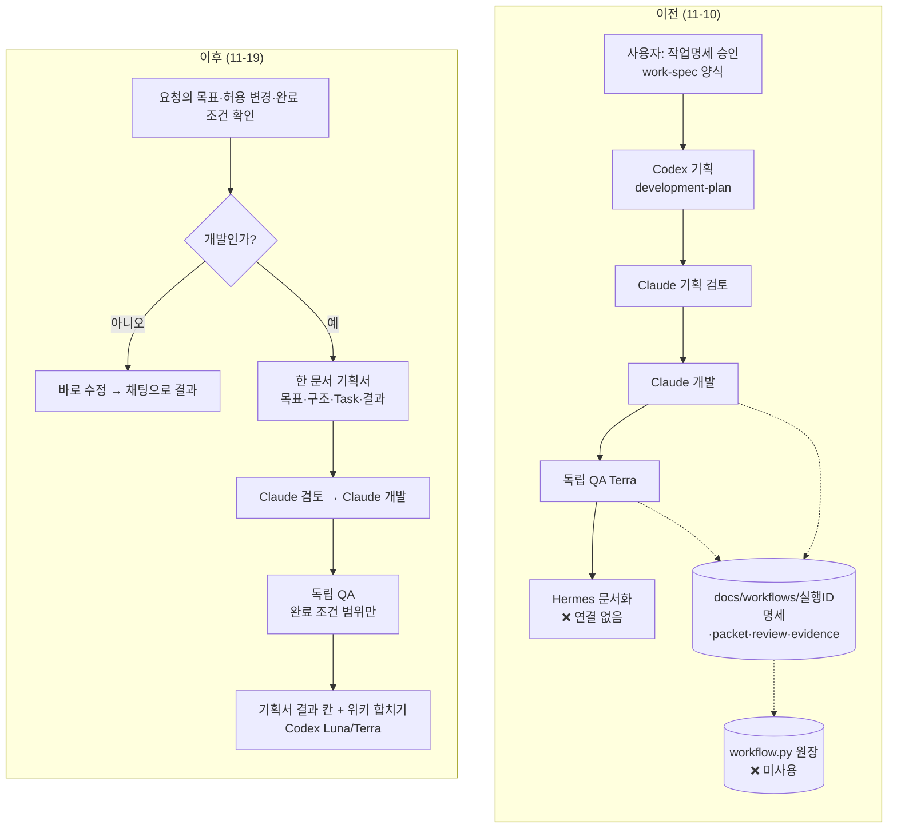
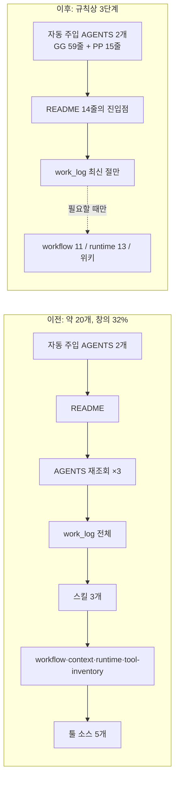
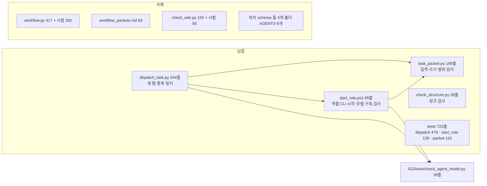
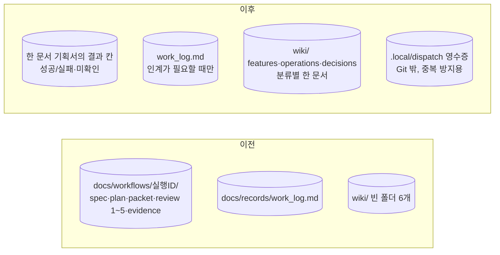
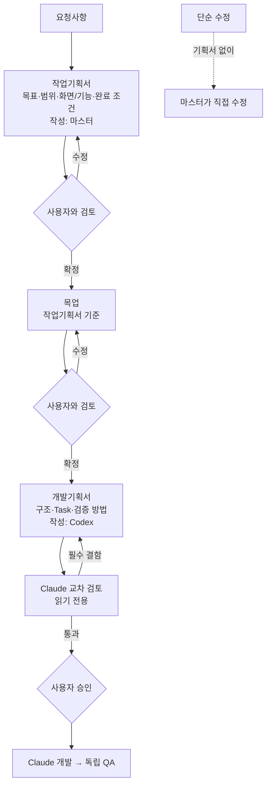

# 점검 보고서 — gptgit/project-prototype 개편 전후 비교 (재점검)

> 작성 2026-11-19 (ICT PC) | 점검자: Claude Code (Opus 5.5) | 대상은 읽기만 했다(작성 전후 `git status --short gptgit/` 변경 0건).
> 비교 기준: 이전 = [2026-11-10 보고서](2026-11-10_project-prototype.md) 시점, 이후 = 커밋 `ec504a9`(2026-11-19, 72개 파일 +279/−2,278줄).
> 경로는 `Aigit` 기준 상대 경로다. `PP/`는 `gptgit/project-prototype/`, `GG/`는 `gptgit/`을 줄인 표기다.
> 표시: **확인**(파일에서 직접 봄) / **추정**(근거로 짐작) / **확인 필요**(아직 못 봄)
> 이번 비교는 **문서·코드 기준**이다. 이 PC의 `~/.codex/sessions`에는 2026-11-18 이후 project-prototype 세션이 없어 개편 뒤 실제 실행 모습은 보지 못했다 — **확인**

## 0. 한눈에 보기

| 항목 | 이전 (11-10) | 이후 (11-19) | 판정 |
| --- | --- | --- | --- |
| PP 규칙 문서 | 약 1,000줄(약 50K 토큰) | 약 150줄 | 크게 줄었다 — **확인** |
| GG 상위 규칙 | AGENTS 59 · common_workflow 68 · 공유 스킬 4개 | **변경 없음** | 마스터에게 자동으로 들어가는 GG/AGENTS는 그대로다 — **확인** |
| 단계 | 요구사항→명세→기획→검토→개발→QA→Hermes 문서화 | 요청 확인→한 문서 기획→(개발일 때만) 검토·개발·QA→결과 칸·위키 | 단계가 짧아졌고 루프는 남았다 — **확인** |
| 실행 기록 | `docs/workflows/<실행ID>/`에 명세·packet·검토·증빙 | 폴더 삭제. 한 문서 기획서의 "결과" 칸 | **확인** |
| 상태 원장 | `workflow.py` 417줄(실제 사용 0회) | 삭제 | 11-10 제안 ④ 해소 — **확인** |
| 위키 | 폴더 6개·지침 9개·검사기, 내용 0개 | 지침 1개·스킬 1개, 내용 3개 | 쓸모 있는 쪽으로 바뀌었다 — **확인** |
| 위키 작성자 | Hermes(연결 도구 없음) | Codex Luna/Terra (`documenter`=codex) | 끊긴 단계가 연결됐다 — **확인** |
| 남은 코드 | 툴 약 1,100줄 + 시험 857줄 | 툴 약 500줄 + 시험 723줄 | 시험은 거의 그대로다(§4) — **확인** |

**새로 생긴 필수 위험 3개**(§3): ① 훅이 다른 PC의 절대 경로를 가리킨다. ② "기획서를 사용자가 승인한 뒤 개발" 문장이 빠졌다. ③ Codex의 확대 해석을 막는 멈춤 규칙이 없다.
**추가 제안**(§3 ⑥, 사용자 요청): "한 문서 기획서"를 **작업기획서 → 목업 → 개발기획서**로 나눈다. 교차 검토는 개발기획서에서만 한다.

### 0-1. 11-10 제안이 반영됐나

| # | 11-10 제안 | 지금 | 근거 |
| --- | --- | --- | --- |
| ① | 시작할 때 `-Encoding UTF8` | 반영 | `PP/tools/start_role.ps1:20` — **확인** |
| ② | 마스터를 `start_role.ps1`로 시작(auto_review) | 알 수 없음 | 시작 방식은 문서에 없다 — **확인 필요** |
| ③ | 자동 주입 AGENTS 재조회 금지, 시작 문서 최소화 | 반영 | `PP/AGENTS.md:6`, `start_role.ps1:20` — **확인** |
| ④ | `workflow.py` 사용 여부 결정 | 삭제로 해소 | — **확인** |
| ⑤ | `CLAUDE.md:3` ↔ `Read(../**)` 불일치 | 그대로 | `PP/CLAUDE.md:3`, `start_role.ps1:43` — **확인** |

---

## 1. 그림으로 보는 전후

> Mermaid 도표다. Obsidian이나 GitHub에서 열면 그림으로 보인다(이 PC에서 화면 렌더링은 확인하지 않았다).

### 1-1. 작업 단계

근거: `PP/docs/workflow.md:5-11`, `PP/AGENTS.md:7-12` — **확인**

### 1-2. 마스터가 시작할 때 읽는 문서

- 이후 PP 쪽 필수 읽기는 약 40줄이다. 자동 주입되는 `GG/AGENTS.md` 59줄과 `GG/docs/common_workflow.md` 68줄은 손대지 않아서 **상위 문서가 PP 문서보다 길어졌다** — **확인**
- `PP/docs/records/work_log.md`는 70줄이고, 그중 약 55줄이 옛 절차의 이력이다(§3-4) — **확인**

### 1-3. 툴 구성

### 1-4. 기록이 남는 곳

---

## 2. 루프는 남아 있나

**남아 있다** — **확인**

- 단계: Codex 기획 → Claude 기획 검토·개발 → 독립 Codex QA를 "필요한 범위에만" 적용한다 (`PP/AGENTS.md:9`, `PP/docs/workflow.md:6`).
- 멈춤 조건: 같은 필수 결함이 두 번 고친 뒤에도 남거나 검토가 세 번 끝나면 반복을 멈추고 원인을 다시 본다 (`PP/AGENTS.md:10`, `PP/docs/workflow.md:8`).
- 반복 방지: 통과한 시험은 이유 없이 다시 하지 않는다 (`PP/docs/workflow.md:7`).

**달라진 점(추정 위험):** 몇 번째 검토인지 적을 곳이 없어졌다. 이전에는 `review-1~5.txt`와 원장이 있었다. 지금은 횟수를 마스터가 기억하거나 기획서 결과 칸에 적어야 한다. 그런데 양식(`PP/templates/development-plan.md:19-22`)에는 횟수 칸이 없다. 대화가 압축되면 "두 번·세 번" 멈춤 조건을 세지 못할 수 있다 — **추정**. 결과 칸에 "검토 n회차" 한 줄을 넣으면 해결된다(§3 제안 ②에 함께 넣음).

---

## 3. 새로 생긴 위험과 필수 개선안

> "꼭 고쳐야 하는 것"만 남겼다. 각 제안은 대상 파일에 붙여 넣을 수 있는 문안 수준이다. 적용은 사용자가 결정한다.

### ① 훅이 다른 PC의 절대 경로를 가리킨다 — **필수**

- `PP/.codex/hooks.json:10`이 `C:\Users\Stargazer\OneDrive\...` 아래의 python과 `agent_model_hook.py`를 부른다. `GG/project-management/.codex/hooks.json:10`도 같은 커밋에서 같은 PC 경로로 바뀌었다 — **확인**
- 이 ICT PC에는 그 경로가 없다 — **확인**
- 그래서 이 PC에서 Codex를 열면 **모든 도구 호출 직전**(matcher `.*`)에 훅이 실패한다. Codex가 그때 도구를 막는지(작업 불가), 경고만 하고 통과시키는지(모델 검사 없음)는 **확인 필요**. 어느 쪽이든 문제다.
- 11-10 보고서 §6-4에서 지적한 "PC를 옮기면 경로가 깨진다"가 실제로 일어났다.
- 제안: 훅 명령에 절대 경로를 쓰지 않는다. 쓸 수 있는 방법은 두 가지다.
  - 가. 명령을 `python -B -X utf8 ../tools/agent_model_hook.py`처럼 **프로젝트 기준 상대 경로**로 둔다. 훅의 실행 폴더가 프로젝트 루트인지는 확인 필요다.
  - 나. 각 PC가 Git 밖 로컬 파일(예: `.local/hooks.json`)을 따로 두고, 저장소에는 예시만 둔다.
- 추천은 가다. 안 되면 나로 간다. 어느 쪽이든 PC를 옮긴 뒤 "금지 모델 시작 명령이 막히는지" 한 번만 시험한다.

### ② "사용자가 기획서를 승인한 뒤 개발" 문장이 빠졌다 — **필수**

- 이전에는 `templates/work-spec.md`와 `docs/requirements.md`가 첫 사용자 결정(작업명세 승인)을 맡았다. 둘 다 삭제됐다 — **확인**
- 지금 남은 것은 다음 세 가지다.
  - `PP/docs/workflow.md:5` "목표·허용 변경·완료 조건을 **확인한다**"
  - `PP/AGENTS.md:5` "요청된 목표·파일 범위에서 실행한다"
  - 기획서 양식 맨 위의 상태 칸 "초안 / 승인 / 진행 / 완료"(`PP/templates/development-plan.md:3`)
- 누가 언제 "승인"으로 바꾸는지는 어디에도 없다 — **확인**
- 확대 해석을 자주 하는 Codex라면 기획서를 쓰자마자 개발로 넘어갈 수 있다 — **추정**
- 제안 문안(`PP/docs/workflow.md` 1번 항목 뒤):
  > 개발 기획서는 사용자가 "승인"이라고 답한 뒤에만 상태를 `승인`으로 바꾸고 Task를 시작한다. 결과 칸에는 검토 회차(n/3)와 같은 결함의 수정 회차(n/2)를 적는다.

### ③ Codex 확대 해석을 막는 하네스 — **필수**

> 하네스: 모델이 정해진 틀 밖으로 나가지 못하게 거는 고정 규칙을 말한다.

- 지금 규칙에는 "범위에서 실행한다", "필요한 범위에만 적용한다"처럼 **판단을 Codex에게 맡기는 말**이 많다. "언제 멈추고 묻는가"는 없다 — **확인**(`PP/AGENTS.md:5,8,9`)
- 사용자 관찰: Codex가 사용자의 작업 수준에서는 필요 없는 일을 자주 한다.
- 제안 문안(`PP/AGENTS.md`에 4줄 추가, 다른 줄은 그대로):
  > - 요청에 없는 개선·정리·리팩터링을 발견하면 **실행하지 말고** 최종 보고의 "제안" 한 줄로만 남긴다.
  > - 단순 수정(문서·설정·한 파일 코드)은 마스터가 직접 하고 담당 위임·QA·위키 반영을 붙이지 않는다. 담당을 쓰려면 먼저 사용자에게 한 줄로 묻는다.
  > - 변경 파일이 요청에서 짐작한 범위보다 3개 이상 많아지면 멈추고 목록을 보여 준 뒤 승인받는다.
  > - 최종 보고 첫 줄에 "요청 외 변경: 없음 / 있음(파일)"을 적는다.
- 숫자(3개)는 예시다. 사용자가 정한다.

### ④ 지워진 것과 남은 글이 맞지 않는다 — 권장(간단)

- `PP/docs/records/work_log.md:25`의 "기존 도구·시험·이력은 보존했다"가 지금 상태와 반대다(그 뒤 삭제됨). 그 아래 11-06~11-09 항목도 지금은 없는 원장·증빙·위키 검사기를 전제로 한다. 줄 16에 "이력이다, 다시 적용하지 않는다"는 안내는 있다 — **확인**
- 재개할 때 마스터가 이 70줄을 읽으면 옛 절차를 다시 떠올릴 수 있다 — **추정**. 제안: 11-18 이전 항목을 별도 파일로 옮기고, `work_log.md`에는 "현재 상태·다음 행동"만 둔다.
- `GG/project-prototype_backup/`(Git에 25개 파일, 2026-11-05)에 옛 규칙 전체가 남아 있다. Codex가 검색하다 옛 규칙을 근거로 쓸 수 있다 — **추정**. 제안: 지우거나, 루트에 "참고 금지·옛 버전"이라는 한 줄 README를 둔다. 지우는 것은 되돌리기 어려우므로 사용자 결정이다.
- `PP/.local/agent-policy-smoke.json`(Git 밖)이 삭제된 `docs/requirements.md`를 가리킨다. 다시 쓰면 검사에서 실패한다 — **확인**(영향 작음)

### ⑤ `CLAUDE.md:3`과 `Read(../**)` 차단 — 11-10에서 이어짐

- `PP/CLAUDE.md:3` "필수 상위 규칙과 AGENTS를 지키되"라고 쓰여 있지만 `start_role.ps1:43`이 상위 폴더 읽기를 막는다. Claude는 `GG/AGENTS.md`를 읽을 수 없다 — **확인**
- 제안: `CLAUDE.md:3`을 "이 파일과 전달받은 Task 입력만 따른다"로 바꾼다. 상위 규칙 중 Claude에게 필요한 것(Git 금지·결제 금지)은 이미 `CLAUDE.md:7`에 있다.

### ⑥ 기획 단계를 "작업기획서 → 목업 → 개발기획서"로 나눈다 — **필수**(사용자 요청 2026-11-19)

> 사용자 요청(2026-11-19): 요청사항 → 작업기획서 → 목업 → 개발기획서 순서로 진행한다. 작업기획서와 목업은 사용자와 함께 검토하므로 에이전트끼리 검토하지 않는다. Codex와 Claude의 교차 검토는 개발기획서에서만 한다.

**지금 문제**
- 개편 때 "한 문서 기획서"로 줄였다. 이 이름이 규칙 곳곳에 절차 이름처럼 박혀 있다 — **확인**
  - `PP/AGENTS.md:7` "기획은 한 문서에…"
  - `PP/docs/workflow.md:5`
  - `PP/README.md:6,14`
  - `PP/docs/runtime.md:6`
  - `PP/CLAUDE.md:5`
- 그 결과 사용자와 함께 보는 문서(무엇을 만들지)와 에이전트끼리 보는 문서(어떻게 만들지)가 한 장에 섞였다. 그래서 사용자가 어디서 승인하는지, Claude가 무엇을 검토하는지가 흐려진다(§3 ②와 같은 원인) — **추정**
- 반면 코드는 이미 두 문서를 전제로 한다 — **확인**
  - `PP/tools/task_packet.py:11`의 필수 항목에 `work_spec`(작업기획서)과 `development_plan`(개발기획서)이 따로 있다.
  - 지금은 둘에 같은 파일을 넣도록 문서에 적어 두었다(`runtime.md:6`).
  - 즉 흐름을 나눠도 **코드는 고칠 필요가 없다**.

**제안 흐름**

| 단계 | 문서 | 누가 검토 | 에이전트 교차 검토 |
| --- | --- | --- | --- |
| 1 | 작업기획서 | 사용자 + 마스터 | 하지 않음 |
| 2 | 목업 | 사용자 + 마스터 | 하지 않음 |
| 3 | 개발기획서 | Codex 작성 → Claude 검토 → 사용자 승인 | **여기서만** |
| 4 | 개발·QA | Claude 개발 → Codex 독립 QA | 기존 그대로 |

- 사용자와 같이 보는 단계(1·2)에 에이전트 검토를 붙이지 않는다. 검토 비용과 대기 시간이 개발기획서 한 곳에만 든다.
- 교차 검토에는 기존 멈춤 조건(같은 결함 2회 / 검토 3회)을 그대로 쓴다. 회차는 개발기획서 결과 칸에 적는다(§3 ②).
- 단순 수정(문서·설정·한 파일)은 지금처럼 기획서 없이 진행한다(§3 ③ 하네스와 같은 기준).

**바꿀 곳(제안)**
- `PP/templates/work-plan.md`를 새로 만든다(작업기획서 양식). 15줄 안팎으로 짧게 쓴다.
  - 항목: 목표, 범위(포함/제외), 작성 기준·근거, 화면 또는 기능 구성, 완료 조건, 상태(사용자 검토 대기/확정), 확정일
- `PP/templates/development-plan.md`는 이름을 유지한다. 맨 위에 "근거: 작업기획서·목업 경로"를 한 줄 넣고, 끝줄의 "한 파일에서 갱신한다" 문구는 "개발기획서 안에서 갱신한다"로 바꾼다.
- `PP/docs/workflow.md`를 위 4단계로 다시 쓴다. 제목은 "작업 프로세스"로 한다.
- "한 문서 기획서"라는 표현을 위 5곳에서 "작업기획서 / 개발기획서"로 바꾼다. `runtime.md:6`은 "`work_spec`=작업기획서, `development_plan`=개발기획서"로 바꾼다.
- `PP/CLAUDE.md:5`: "기획 검토는 전달된 개발기획서만 대조한다. 작업기획서·목업은 근거로만 읽는다."

**사용자가 정할 것**
- 목업을 어디에 둘지(예: `docs/mockups/`)와 형식(이미지·HTML 등)
- 작업기획서·목업은 누가 쓸지. 제안은 마스터(Astra)가 사용자와 대화하며 쓰는 것이다.

---

## 4. 코드가 정말 필요한가

### 4-1. 판단 요약

| 파일 | 줄 | 하는 일 | 판단 |
| --- | --- | --- | --- |
| `task_packet.py` | 159 | 입력 경로·쓰기 범위·역할 검사. documenter는 `wiki/*.md`만, 규칙 파일 금지 | **유지.** 담당이 범위 밖 파일을 건드리지 못하게 하는 핵심 장치다 |
| `start_role.ps1` | 65 | 모델 검사, 유료 API 변수 차단, 구독 확인, CLI 시작 | **유지.** 결제 사고를 막는 곳이다 |
| `GG/tools/check_agent_model.py` | 39 | Astra/Luna/Terra 허용 검사 | **유지** |
| `dispatch_task.py` | 244 | 검사 → 새 탭 → pane 준비 확인 최대 3회 → `start_role` 실행 → 중복 방지 영수증 | **남기되 절반 이하로 줄일 수 있다**(4-2) |
| `check_structure.py` | 28 | 필수 파일 11개·상대 링크 검사 | 선택. 문서가 15개 남짓이라 없어도 된다 |
| `tests/test_dispatch_task.py` | 479 (26건) | 위 dispatcher의 이상 케이스 | **크게 줄일 수 있다**(4-3) |
| `tests/test_start_role.py` | 128 (9건) | CheckOnly 인수 검사 | 유지(작음) |
| `tests/test_task_packet.py` | 116 (14건) | 쓰기 범위 검사 | 유지 |

### 4-2. dispatch는 꼭 필요한가

- **있어야 하는 이유(확인):** 규칙 세 가지를 사람이나 Codex의 기억 대신 코드로 지킨다.
  1. 마스터 탭을 쪼개지 않고 새 탭에서 시작한다.
  2. 같은 Task를 두 번 시작하지 않는다(영수증).
  3. 모델 검사를 거치기 전에는 시작하지 않는다.
- 없애면 마스터가 herdr 명령을 직접 친다. 11-09에는 약 120회를 쳤다. 그러면 위 세 규칙이 다시 문서 의존이 된다.
- **줄일 수 있는 이유(확인 + 추정):**
  - 줄 189~225(약 40줄)는 "새 pane이 준비됐는지 최대 3번 확인"하는 부분이다.
  - 줄 27~110(약 85줄)은 그 확인을 위한 진단·검증 함수다(`_safe_observed`, `_check_pane_ready`).
  - 11-09에 herdr 0.9.5의 응답 차이로 덧붙인 것들이다.
  - 같은 저장소의 `GG/tools/start_managed_agent.py:54-80`은 같은 일(새 탭 → 시작)을 `herdr agent start` 한 번으로 약 25줄에 한다 — **확인**
  - 같은 방식으로 다시 쓰면 dispatch는 **약 80~100줄**이 될 것으로 본다 — **추정**. 다만 지금 방식이 PowerShell 7 전용 실행(`-EncodedCommand`)을 거치는 이유가 있어, `herdr agent start`로 바꿔도 같은 셸에서 도는지는 **확인 필요**다.
- **추천:** 지금 당장 다시 쓰지는 않는다. dispatcher를 다음에 고칠 일이 생기면 그때 shared 방식으로 줄인다. 지금은 잘 돌아간다는 11-09 기록이 있고(`work_log.md:37`), 다시 쓰면 실연결 시험을 또 해야 하기 때문이다.

### 4-3. 시험 코드

- 26건 중 핵심 8건이면 충분하다고 본다 — **추정**
  - 유지 후보: `test_dry_run_calls_no_herdr_and_creates_no_receipt`, `test_apply_missing_caller_context_rejected`, `test_duplicate_receipt_blocks_second_dispatch`, `test_invalid_model_rejected_before_any_herdr_or_receipt`, `test_mismatched_caller_project_blocks_before_claim`, `test_tab_creation_uses_new_tab_and_checks_cwd`, `test_timeout_records_uncertain_and_no_retry`, `test_documenter_dispatch_and_model_gate`
  - 정리 후보: pane 준비·진단 관련 15건(`test_process_info_*`, `test_*_diag_*`, `test_malformed_*`, `test_missing_pane_id_*`, `test_empty_cwd_*`, `test_non_shell_*`, `test_silent_*` 등)
- 시험 이름 `test_hermes_documenter_is_blocked_before_receipt`는 이제 "Hermes provider가 packet 검사에서 거부된다"는 뜻이 됐다. 이름과 내용이 맞는지 확인이 필요하다(이번에 시험은 실행하지 않았다).
- **추천:** 4-2와 묶는다. dispatch를 줄일 때 시험도 함께 줄인다. 시험만 먼저 지우면 지금 코드의 보호막만 사라진다.

### 4-4. 새로 써야 할 코드

- **없다.** 필수 개선 ①~③은 설정 1개와 문서 몇 줄로 해결된다.
- 코드 변경이 필요한 것은 dispatch 축소(선택) 1건뿐이다.

---

## 5. 스킬 재제안 (최소)

### 5-1. 지금 있는 것

| 위치 | 스킬 | 줄 | 상태 |
| --- | --- | --- | --- |
| PP | delegation-reporting | 13 | 담당 실행·회수. 유지 |
| PP | wiki-editor | 30 | 분류표·짧은 YAML. 유지 |
| GG | project-handoff | 31 | 재개·인계 |
| GG | delegation-reporting | 28 | 공통 위임 |
| GG | project-planning | 27 | 초기 기획 |
| GG | simple-user-guide | 64 | 가이드 작성 |

사라진 것: 위키 schema·틀 4개·`check_wiki.py`, `work-spec` 양식. 위키를 "분류별 한 문서에 합친다"로 바꿨으니 사라져도 된다 — **확인**

### 5-2. 제안

1. **새 스킬은 만들지 않는다(추천).** 확대 해석을 막는 규칙(§3 ③)은 스킬이 아니라 `AGENTS.md`에 두어야 한다. 스킬은 "필요할 때 읽는 것"이라, 정작 범위를 넓힐 때 읽히지 않는다. `AGENTS.md`는 매번 자동으로 들어간다.
2. **로컬 스킬 2개는 그대로 둔다.** 이미 13·30줄이다.
3. **GG 공유 스킬은 다음에 손볼 대상이다.** PP는 줄었는데 GG의 `delegation-reporting`(28줄)과 `project-handoff`(31줄)는 11-06 그대로다. 마스터가 위임할 때 공유본과 로컬본을 둘 다 읽는다(로컬 `SKILL.md:9`가 공유본을 가리킴). 공유본을 로컬과 같은 밀도로 줄이면 위임할 때마다 읽는 양이 줄어든다. project-management도 같이 쓰는 파일이라 그쪽 영향 확인이 필요하다 — **추정**
4. 위 3을 하지 않는다면 대안이 있다. 로컬 `delegation-reporting`에 "공유본은 처음 한 번만 읽는다" 한 줄을 넣는다.

> 이 폴더의 점검용 스킬 후보(`skill_candidates.md`)는 이번 요청 범위가 아니다.

---

## 6. 사용자 결정 목록

| # | 결정할 것 | 추천 |
| --- | --- | --- |
| 1 | 훅 경로를 상대 경로(가)로 할지 PC별 로컬 파일(나)로 할지 | 가, 안 되면 나 |
| 2 | §3 ② 승인 문장 + 회차 기록 추가 | 적용 |
| 3 | §3 ③ 하네스 4줄 추가, "3개 이상" 기준값 | 적용, 숫자는 사용자 결정 |
| 4 | `work_log` 옛 이력 분리 | 적용 |
| 5 | `project-prototype_backup/` 삭제 또는 안내 README | 안내 README(삭제는 되돌리기 어려움) |
| 6 | `CLAUDE.md:3` 문구 정리 | 적용 |
| 7 | dispatch·시험 축소 | 다음에 dispatcher를 고칠 때 함께 |
| 8 | GG 공유 스킬 축소 | project-management 영향 확인 후 |
| 9 | §3 ⑥ 작업기획서 → 목업 → 개발기획서 흐름, 교차 검토는 개발기획서만 | 적용(사용자 요청) |
| 10 | 목업 위치·형식, 작업기획서 작성자 | 사용자 결정(제안: 마스터가 작성) |

## 7. 남은 확인 사항

- 훅 명령이 실패할 때 Codex가 도구를 막는지 통과시키는지 (§3 ①)
- 개편 뒤 실제 실행: 이 PC에 세션 기록이 없다. 다른 PC(Stargazer)에서 돌린 기록이 있다면 그쪽에서 확인해야 한다.
- 마스터를 무엇으로 시작하는지(`start_role.ps1` 여부, 11-10 제안 ②)
- `herdr agent start`가 PowerShell 7 시작 방식과 함께 쓰이는지 (§4-2)
- 이번에 PP 시험은 실행하지 않았다. 이 보고서는 코드를 읽고 판단한 것이다.
- Mermaid 화면 렌더링

## 8. 비밀값 관련

- `PP/config/runtime.local.json`, `PP/.local/`의 값은 옮기지 않았다. `.local/`은 파일 이름과 참조 경로만 확인했다.
- 훅 경로는 PC 사용자 폴더 이름까지만 적었다.
