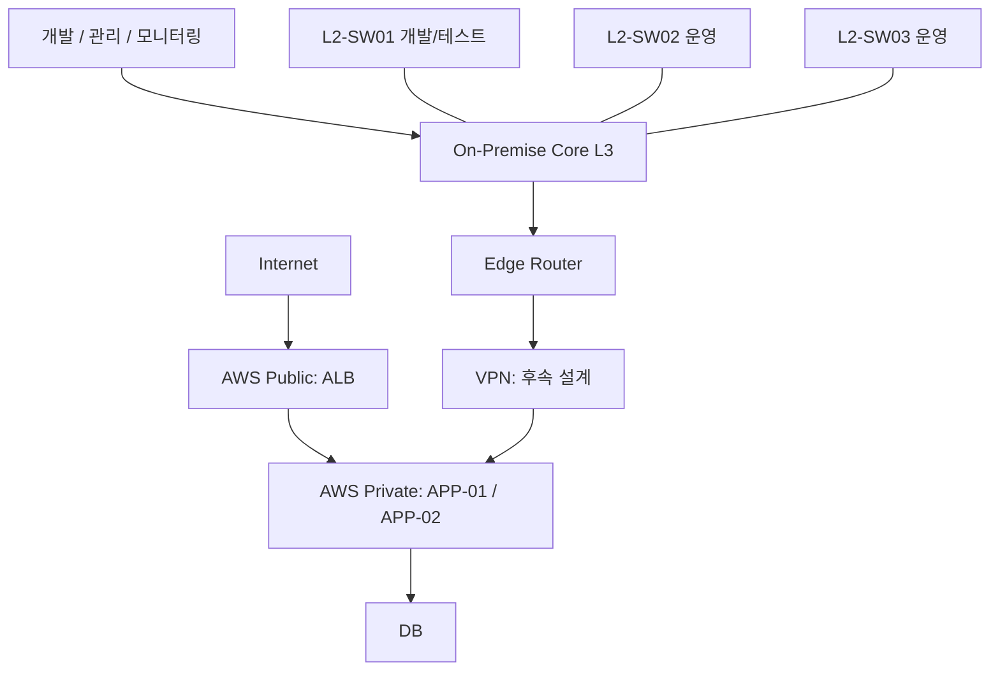

# 전체 설계 및 구축 단계

> 2026-10-18 · 기존 진행상황 `$2`·`$4`·`$5`의 설계·Roadmap을 통합. 구현 완료도는 [진행상황](network%20project%20진행상황.md)에서만 관리한다.
> [범위](../01_requirements/프로젝트%20범위.md) · [실습 환경·주소](실습%20환경%20및%20주소.md) · [검증 근거](../03_verification/Phase1%20검증.md)

## $1 목표 구조

- 개발/테스트 영역에는 개발 PC·Test Server·Test DB를 배치하는 방향이다. 운영 영역은 운영 시스템·사용자/업무 단말을 포함한다.
- AWS는 사내 L2 단말 영역이 아니라 Edge 외부의 Cloud 영역이다. Public ALB와 Private APP/DB 구성은 참고 모델이며 AWS 세부 배치·연결 방식은 아직 미정이다.
- 구조 이해 → 역할·통신 흐름 정의 → IP/VLAN/Subnet/Routing 설계 → 단순 환경 구현 → 단계적 확장의 순서로 접근한다.
- 현재 구현 포트·주소는 목표 구조와 다를 수 있다. 현재는 ASW1 한 대로 두 VLAN을 검증하며 운영 L2 두 대를 이미 구축했다고 해석하지 않는다.

## $2 VLAN·주소 설계 방향

| 항목 | 현재 결정 수준 | 후속 설계 |
| --- | --- | --- |
| 관리망·실습망 분리 | [확정] VMnet8 관리 / VMnet2 실습 | 실제 값은 환경 문서가 기준 |
| VLAN10 개발/테스트 | [검토] 2026-10-18 사용자 제안과 적합성 검토 | 기존 검증 대역의 최종 채택·단말 배치 확정 |
| VLAN20 운영 | [검토] 위와 동일 | 운영 L2 두 대의 연결·단말 배치 구체화 |
| Core 라우팅·Access 분리 | [확정] 게이트웨이·라우팅은 CORE, ASW는 Access/uplink | 실제 인터페이스는 환경 문서 참조 |
| 전체 호스트 IP·DHCP·ACL | 미설계 | 고정 주소·임대 범위·허용 흐름을 함께 설계 |

현재 VLAN·IP는 기능 검증값이다. VLAN 역할 방향을 전체 회사망의 최종 주소 계획으로 확대하지 않는다. 같은 VLAN20을 쓰는 운영 스위치는 같은 네트워크이며, VLAN 간 라우팅만으로 접근이 제한되지 않는다. NAT 대상 선택 ACL과 접근 제어 ACL도 구분한다.

## $3 서비스·관리 통신 기준

| 출발지 | 목적지 | Protocol / Port | 목적 |
| --- | --- | --- | --- |
| Client | Web Server | HTTPS / 443 | 웹서비스 |
| Web Server | DB | TCP / 3306 | 조회·저장 |
| Monitoring | Linux Server | HTTP/TCP / 미정 | Metric 수집 |
| Monitoring | Network Device | SNMP / 161 | 장비 모니터링 |
| Python | Network Device | SSH / 22 | 조회·자동화 |
| Python | AWS | HTTPS / 443 | AWS API |
| On-Prem | AWS | VPN / 방식·포트 미정 | 사설망 연결 |

이 표는 학습용 통신 기준이며 접근 정책 적용·서비스 검증 완료를 뜻하지 않는다. Monitoring은 상태 확인, Python은 관리·운영 자동화 영역이며 서비스 데이터 경로에 넣지 않는다.

## $4 구축 단계

단계별 실제 상태·다음 작업은 [진행상황 `$5`·`$8`](network%20project%20진행상황.md#phase-status)에서 확인한다. 아래는 단계의 범위이며 완료 상태 사본을 만들지 않는다.

| 단계 | 목적·구현 범위 | 학습·검증 항목 |
| --- | --- | --- |
| Phase 0 전체 설계 | 전체 인프라, On-Prem/AWS 역할, Hybrid·HA·보안·운영 방향 | 누가 누구와 어떤 IP/Port/Protocol로 통신하는가 |
| Phase 1 VMware / PNETLab Network | 관리·실습망, 외부 Linux 연결, 이미지 기능, Router–Core, VLAN/Trunk/SVI, 주소·정적 경로, Linux WEB-01 연결 기반 | Ethernet/MAC/ARP, Access/Trunk, STP/RSTP, Gateway, Static/Default Route, DHCP/DNS, Ping·테이블 대조 |
| Phase 2 Linux Server | WEB-01·WEB-02·DB-01 | Linux, Nginx/Apache, Python Web Application, MariaDB |
| Phase 3 Web Service | Client → HTTP/HTTPS → Web → DB TCP 3306 | GET /, GET /users, POST /users 등 통신 확인용 최소 기능 |
| Phase 4 Network Redundancy | 단일 장비 검증 후 필요한 이중화 확장 | STP/RSTP, LACP, Gateway/Routing Redundancy, ECMP; Switch/Link/VLAN/Routing 장애 |
| Phase 5 AWS / Hybrid Cloud | 사설망 연결, 개발·운영 환경에서 AWS 접근 | VPC, Public/Private Subnet, Route Table, IGW, SG, NACL, EC2, ALB, VPN, 비용·장애 검증 |
| Phase 6 Monitoring | Prometheus, Grafana, Node Exporter, SNMP Exporter | Linux CPU/Memory/Disk/Network, Server, 장비 Interface·장애 상태 |
| Phase 7 Python Automation | Netmiko, Paramiko, Boto3, Requests 후보 | 상태 조회 → Health Check → 정보 수집 → 출력·기록 |
| Phase 8 장애 / 보안 / 운영 | WEB-01 Down, Link Down, DB Port 차단, EC2 Down, VPN Down, Routing/VLAN 장애 | 증상·범위 확인 → 원인 분석 → 조치 → 재검증 → 문서화 |

Phase 7의 초기 흐름은 Monitoring 장애 감지 → Python 상태 수집 → 엔지니어 판단이다. 자동 복구는 초기 범위에 넣지 않는다. 서비스·관리 도구명은 계획이며 설치 완료로 해석하지 않는다.

## $5 참고 장비 기준

실습실 Cisco 2800 Router 1대, Catalyst 3560 24포트 L3 2대, Catalyst 2960 48포트 L2 1대·24포트 L2 2대는 학습 역할의 참고 기준이다. 최신 Catalyst 실물 모델의 전체 기능을 가상 이미지가 대표하는 것은 아니다. 실제 사용 Image와 기능 검증 범위는 [환경](실습%20환경%20및%20주소.md#images)·[검증](../03_verification/Phase1%20검증.md#scope)을 따른다.

## $6 변경 이력

| 날짜 | 내용 |
| --- | --- |
| 2026-10-18 | 반복된 Hybrid 다이어그램·역할 설명 통합, 기존 9개 Phase의 범위 보존, VLAN 역할은 검토 수준으로 유지 |
