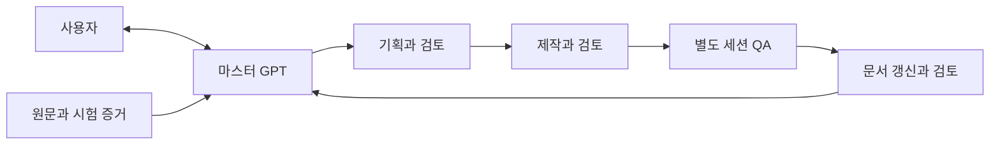

# 프로젝트 관리 자동화 wiki

> 버전: 0.1 | 최종 수정: 2026-10-27

이 wiki는 현재 구조를 설명하는 탐색 창구다. 실행별 상세 상태는 [작업기록](../docs/04_records/management_log.md)과 해당 실행 기록, 규칙은 [AGENTS](../AGENTS.md), 상세 절차는 [자동화 워크플로](../docs/02_design/automation_workflow.md)를 기준으로 한다. 이 페이지를 별도 상태 원본으로 유지하지 않는다.

그림은 목표 역할·인계 구조다. 모든 연결이 현재 구현·검증되었다는 뜻은 아니다. 운영 기록 자동화와 실제 LLM 연결 상태를 구분한다.

- [역할과 인계](../docs/00_rules/roles.md): 누가 무엇을 만들고 검토하는지.
- [공통 자동화 흐름](../docs/02_design/automation_workflow.md): 단계·증거·차단·재개 기준.
- [문서 책임 결정](adr/0001-workflow-records.md): 실행 기록과 wiki·가이드를 분리한 이유.
- [사용자 가이드 폴더](../guide_docs/): 사용자가 따라 할 절차.
- [로컬 구현 검증과 남은 작업](../docs/03_verification/automation_validation.md): 완료 근거와 미검증 범위.

Obsidian에서는 이 프로젝트의 Markdown을 직접 열어 읽는다. wiki의 별도 사본이나 자동 동기화는 구성하지 않는다. 중요한 결정만 ADR로 남기고 사용법·현재 구조 설명을 ADR에 모두 넣지 않는다.
