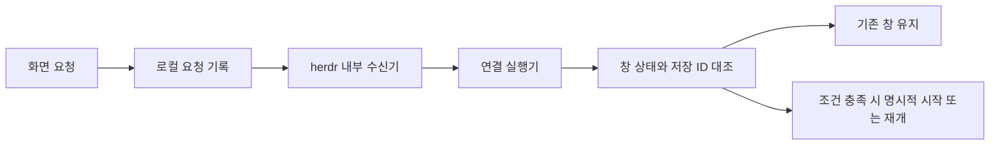

# AI 창 재사용과 명시적 대화 재개

> 원문 0.5(2026-11-02)까지의 설계·시험 이력이다. 현재 환경에서의 호환이나 복원 성공을 보증하지 않는다.

화면은 요청을 저장하지만 기존 창에 명령을 직접 입력하거나 수신기를 외부에서 시작하지 않는다. 수신기·실행기는 실제 herdr 내부에서 요청 ID와 현재 역할 상태를 확인하도록 설계됐다. 수신기 기본 동작은 기존 창 유지이며 누락 역할 시작은 별도 명시 조건이다. 전송 전 이력과 잠금으로 중복을 막고, 중간 실패의 불명확 상태를 자동 재전송하지 않는다. 이는 이번 위키 작업의 수동 pane 위임이나 자동화 완주의 증거가 아니다. [근거: 시작 화면의 요청과 자동 요청 수신](../../raw/docs/02_design/agent_session_lifecycle.md#시작-화면의-요청과-내부-처리)

당시 역할별 대화 기록은 프로젝트 경로와 역할로 구분하고 `.local/agent-sessions/`에 보관했다. 기본 틀의 빈 conversation_sessions는 실제 연결 기록이 아니다. 창 재사용 가능, 현재 대화 UUID 일치, 실제 재개 성공은 서로 다른 판정이다. 창이 있어도 UUID가 없으면 미확인이고, 저장 ID와 현재 UUID가 다르면 차단한다. 유효한 ID가 일치해도 작업 중이거나 승인 대기인 창에 새 프롬프트를 자동 전송하지 않는다. 기본 조회는 저장 기록만 읽으며 실시간 확인이 아니다. [근거: 경계와 저장, 시작 판정](../../raw/docs/02_design/agent_session_lifecycle.md#시작-판정)

정확한 저장 ID의 명시적 재개만 허용하고 가장 최근 대화를 추측하지 않는다. 동일 역할의 잠금은 해당 시작기 경로에만 적용되며 수동 CLI까지 통제하지 않는다. 경로 해시는 보안 격리가 아니다. PC·경로 변경은 실제 대화와 위치 재대조가 필요하다. [근거: 실행 연결과 조회](../../raw/docs/02_design/agent_session_lifecycle.md#실행-연결과-조회)

당시 상태 판정·수신기는 모의 검사로 검증했으며 실제 창 생성·종료 후 복원과 수신기 전 경로는 미검증이었다. 일부 내부 Live·ReuseOnly 결과는 사용자 전달이며 원문 출력 파일이 없어 직접 관찰로 승격하지 않는다. `CheckOnly`는 인증·설정 검사이지 창 복원이 아니다. [근거: 검증과 남은 범위](../../raw/docs/02_design/agent_session_lifecycle.md#검증과-남은-범위), [최신 인계](../../docs/04_records/management_log.md)

## 원문 이력

0.1은 기록·역할 판정, 0.2는 창과 ID 확인 분리, 0.3은 연결 요청과 실행기, 0.4는 수신기, 0.5는 Codex 경로 선택과 PC별 시작 조건을 추가했다. 상세는 [원문 변경 이력](../../raw/docs/02_design/agent_session_lifecycle.md#변경-이력)에 보존한다.
