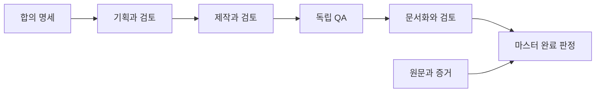

# 프로젝트 관리 자동화 워크플로

> 원문 0.3(2026-10-28)은 당시 승인된 목표와 로컬 설계다. 현재 이 관리 프로젝트에서 자동화 운영은 현행 기능이 아니다.

목표는 사용자와 대표 결과·범위를 합의한 뒤 기획, 제작, 독립 QA, 문서화를 거쳐 증거를 제시하는 것이었다. 합의 명세와 AI 실행계획은 역할을 나누고 작은 작업은 한 문서의 두 부분으로 합칠 수 있다. Phase는 큰 결과, Task는 산출물 단위, Step은 실행 순서다. 자체 시험과 별도 QA는 구분하고 실제 세션의 연결·전달·회수는 따로 입증해야 한다. [근거: 목표와 요구사항 단계](../../raw/docs/02_design/automation_workflow.md#2-요구사항과-단계)

Task별 산출물·담당·명세 버전·입출력·인계 조건을 정하고 새 세션에는 관련 결정과 원본의 필요한 부분만 제공하도록 설계했다. 수정은 같은 Task 세션을 재사용할 수 있지만 제작과 독립 검토는 분리한다. 맥락 복원은 최신 공식 기록, 관련 결정·설계, 미저장 대화 순으로 대조하고 결정·미구현·미검증·보류를 나눈다. 이 구조는 실제 자동 전달 성공을 보장하지 않는다. [근거: Task 설계와 맥락 복원](../../raw/docs/02_design/automation_workflow.md#21-task-설계와-세션-전환)

상태는 대기·진행·검토·수정·차단·완료다. 승인 명세·고정된 결과·검토와 시험 증거가 없거나 필수 결함이 남으면 완료하지 않는다. 실행 ID와 작업 ID는 중복을 식별하고 재작업 시 후속 승인을 무효화하되 이전 회차와 증거를 보존한다. 기록은 상태 파일, 시간순 timeline, 명시 제출 원문, wiki 설명과 사용자 가이드로 책임을 나눈다. 실행별 `04-wiki`는 검토 증거이지 wiki 전체 사본이 아니다. [근거: 상태·증거 및 기록 책임](../../raw/docs/02_design/automation_workflow.md#3-상태증거재시도), [문서 책임 결정](../decisions/0001-workflow-records.md)

당시 운영 영역과 Docker 작업 영역 분리를 구상했지만 Docker 자체가 완전한 격리 증거는 아니다. 구독 확인이 실패하면 유료 API로 자동 전환하지 않고, 도구 설치·작은 전달·실제 모델 연결·전체 완주를 구분했다. 상태 검사기는 파일과 전이의 일관성을 확인할 뿐 제출자의 신원이나 진실성을 인증하지 않는다. process_debug의 당시 On/Off는 추가 표시·측정을 구분했으나 현행 의무는 종료됐다. [근거: 환경·도구·비용](../../raw/docs/02_design/automation_workflow.md#5-환경도구비용), [현행 규칙](../../AGENTS.md#작업-재개와-과거-프로세스-점검)

## 원문 이력

0.1(2026-10-27)은 단계·증거·비용 기준, 0.2는 재작업·스냅샷·인증 패턴 검사, 0.3(2026-10-28)은 Task 세션과 맥락 복원·당시 점검 기준을 추가했다. [원문 이력](../../raw/docs/02_design/automation_workflow.md#변경-이력).
