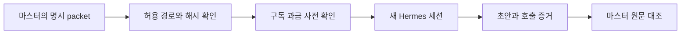

# Hermes 제한형 기록 worker

> ENV-01 원문 0.1(2026-10-28)의 제한형 설계와 시험 범위다. 현행 자동화 연결이나 실행 지시가 아니다.

worker는 명시적으로 전달된 기록 요약 또는 wiki 초안만 회수하며 승인 상태·timeline을 직접 바꾸거나 원본을 최종 승인하지 않는다. `sources=[]`는 문서를 자동 전송하지 않는 설정이다. 당시 추가 source는 세 지정 경로만 허용했고 전체 파일 SHA-256과 1부터 세는 양끝 포함 행 범위를 확인하며 파일당 200행까지 전달했다. 당시 허용 경로는 과거 실행 기준이며 지금의 raw 보관 경로로 자동 전환된 것이 아니다. 가이드와 보류된 실행 자료는 허용 목록 밖이었다. [근거: 입력과 실행](../../raw/docs/02_design/hermes_worker.md#입력과-실행)

호출 직전 지정 모델의 구독 과금 응답을 확인하고 실패·누락·다른 과금이면 전송하지 않는 설계였다. 고정된 단일 새 세션, 빈 작업 디렉터리와 도구 제한은 OS 격리를 보장하지 않는다. 계정·설치·버전이 바뀌면 당시 확인을 현재에도 적용할 수 없다. 호출 선점과 결과 파일은 같은 작업 ID의 중복 전송과 덮어쓰기를 막지만 OS의 변조 불가 저장은 아니다. [근거: 호출·비용 경계와 결과](../../raw/docs/02_design/hermes_worker.md#호출비용-경계)

2026-10-28 합성 입력의 오프라인 13개 시험과 실제 1회 호출은 구분된다. 실제 호출은 초안 회수와 해당 세션의 빈 도구 목록을 확인했으나 실제 기록 요약 품질·독립 QA·전체 완주를 확인하지 않았다. 구독 확인은 그 시점의 응답일 뿐 향후 과금 정책을 강제하지 않는다. [근거: 검증 범위](../../raw/docs/02_design/hermes_worker.md#검증-범위)

## 원문 식별자

원문은 ENV-01, 버전 0.1, 2026-10-28이며 별도 변경 이력 표는 없다. 재전송·실패 조건은 [과거 운영 설명](../operations/historical_automation.md)에 정리했다.
