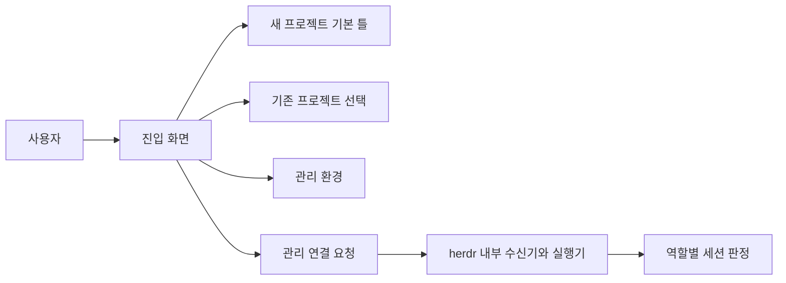

# 프로젝트 개설과 공통 진입점

> 원문 1.0(2026-10-27)의 구조와 후속 세션 설계를 설명한다. 과거 구현 설명은 현재 실행·호환 보증이 아니다.

관리 프로젝트는 공통 환경과 프로세스를 개선하고, 개별 프로젝트는 자기 작업과 원본을 관리한다. 화면은 개설·선택·관리 환경을 분기하며, 신규 목적 입력이나 폴더 생성은 상세 기획·제작 승인이 아니다. 같은 이름의 폴더는 덮어쓰지 않고, 기존 프로젝트 선택은 기존 규칙과 문서를 변경하거나 기본 틀을 주입하지 않는 구조였다. [근거: 목적과 책임, 구현된 흐름](../../raw/docs/02_design/project_entry.md#구현된-흐름)

기본 틀은 README의 진입점, AGENTS의 권한, `docs/project.md`의 목적·요구, `docs/04_records/work_log.md`의 개설 기록, 개설 메타데이터를 분리했다. 관리 이력·보류·인증·대화 ID를 복제하지 않으며 변경된 틀을 기존 프로젝트에 자동 적용하지 않는다. 실제 보관된 틀과 원문에서 기술한 생성 메타데이터는 구분한다. 사용자 지정 위치는 그 상위 규칙을 확인해야 한다. [근거: 공통 기본 틀](../../raw/docs/02_design/project_entry.md#공통-기본-틀), [보관 틀](../../raw/templates/project-v1/README.md)

경로 해시는 세션 구분자이지 접근 통제가 아니다. 폴더 이동 시 자동 이전을 보장하지 않는다. 화면은 요청을 저장할 수 있으나 내부 수신기는 별도 기동 조건을 가진다. 초기 원문의 연결 전 표현과 11월의 구현·모의 시험은 시점이 다르며, 후속 문서도 실제 창 생성·복원을 완전히 입증하지 않는다. 세션 ID 확인, 실행 여부와 사용자 보고는 [세션 구조](agent_session_lifecycle.md)에서 구분한다. 최신 인계상 관리 프로젝트는 개선 원본이고 project-prototype은 독립 시험 대상이다. [근거: 미연결 기능과 제한](../../raw/docs/02_design/project_entry.md#아직-연결하지-않은-기능), [최신 인계](../../docs/04_records/management_log.md#확정된-역할)

## 원문 식별자

원문은 버전 1.0, 2026-10-27이며 별도 변경 이력 표가 없다. 당시 가이드 제작·기존 자료 전송 보류와 유료 호출·Git 제한은 실행 허가로 바뀌지 않는다.
