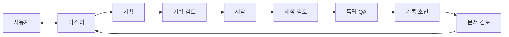

# 자동화 역할과 인계 기준

> 과거 역할 기준 0.2(2026-10-28)를 주제별로 재구성했다. 자동화 운영은 현행 기능이 아니며 현재 권한은 [루트 규칙](../../AGENTS.md)이 우선한다.

이 그림은 당시 목표 역할과 인계 관계다. 실제 세션·제공자 연결이나 작업 완료를 뜻하지 않는다. 마스터는 사용자 요청과 승인 명세에서 범위·우선순위·담당을 정하고 고정된 결과와 근거를 대조해 보고한다. 기획은 요구사항 번호에 연결된 실행계획과 완료 조건을 만들고, 제작은 산출물과 자체 시험을 제출한다. 기획·제작 검토자는 승인 명세와 결과를 읽기 전용으로 대조해 필수 결함을 돌려보내며 원본을 고치지 않는다. QA는 별도 세션에서 고정된 산출물·시험 입력으로 실제 결과를 확인한다. Hermes는 기록·wiki 초안을 돕고 문서 검토자는 설명과 근거를 대조한다. 어느 담당도 자신의 결과를 최종 승인하지 않는다. [근거: 역할 기준, 책임과 경계](../../raw/docs/00_rules/roles.md#책임과-경계)

독립 검토는 작성자와 분리된 세션, 교차 검증은 서로 다른 제공자의 검증이다. 같은 GPT를 쓰는 Hermes와 GPT 검토는 독립 세션일 수 있으나 제공자 교차 검증은 아니다. 세션 이름이나 서로 다른 문자열만으로 독립성이 증명되지는 않는다. 실제 제공자·세션·대체 이유와 미충족 조건을 기록한다. 형식 검사는 가능한 스크립트에 맡기고 모델은 구독 범위와 난이도에 맞춰 선택한다. [근거: 세션과 모델](../../raw/docs/00_rules/roles.md#세션과-모델)

당시 Task별 담당·입출력·완료·검토·인계를 계획하고 같은 파일의 동시 쓰기를 피했다. 인계에는 실행·작업 ID, 명세 버전, 역할·실제 세션, 산출물 버전, 결과·증거와 미해결 사항이 필요했다. 충돌은 사용자 목표, 승인 명세, 재현 증거 순으로 대조하고 비용·범위·공개·되돌리기 어려운 결정은 사용자에게 남긴다. process_debug 응답별 의무는 이후 종료됐다. 이번 herdr 수동 담당 위임은 이 과거 자동화가 작동한다는 증거가 아니다. [근거: 인계와 충돌 해결](../../raw/docs/00_rules/roles.md#인계와-충돌-해결), [현행 규칙](../../AGENTS.md#작업-재개와-과거-프로세스-점검)

## 원문 식별자와 이력

원문 0.1(2026-10-27)은 역할·세션·제공자와 인계를, 0.2(2026-10-28)는 Task별 설계·확대 인계·맥락 복원과 당시 점검 책임을 추가했다. 상세 변경 이력은 [보관 원문](../../raw/docs/00_rules/roles.md#변경-이력)에 유지한다.
